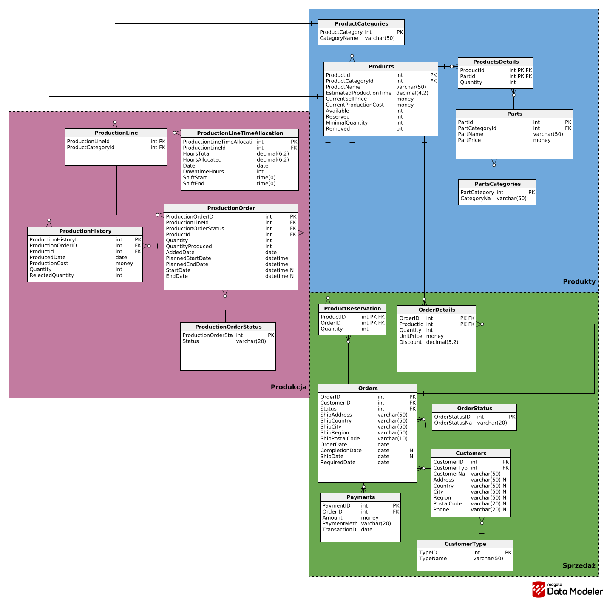

# Podstawy baz danych

Środa 13:15\
nr zespołu: 6

**Autorzy:**\
Błażej Turczynowicz\
Kacper Mucha\
Maciej Życki

# 1. Wymagania i funkcje systemu

## Historyjki użytkowników

### 1. Klient

- US-01: Przeglądanie oferty\
  Jako klient chcę przeglądać dostępne meble w ofercie, aby wybrać produkty odpowiednie do mojego biura.
- US-02: Składanie zamówienia z magazynu\
  Jako klient chcę złożyć zamówienie na dostępne produkty, aby szybko otrzymać meble.
- US-03: Zamówienie produktów do produkcji\
  Jako klient chcę zamówić produkty, których nie ma w magazynie, aby wyposażyć nową salę konferencyjną w danym temrinie.

### 2. Sprzedaż

- US-04: Przyznawanie rabatu\
  Jako pracownik sprzedaży chcę przydzielić rabat procentowy do poszczegolnych produktow w zamówieniu klienta, aby zachęcić do większego zakupu.
- US-05: Historia zamówień klienta\
  Jako pracownik sprzedaży chcę zobaczyć historię zamówień klienta wraz z rabatami, aby lepiej go obsłużyć.
- US-06: Stan magazynowy produktów\
  Jako pracownik sprzedaży chcę sprawdzić aktualny stan magazynowy produktów gotowych, aby wiedzieć co jest dostępne do sprzedaży.

### 3. Produkcja

- US-07: Sprawdzenie dostępności części\
  Jako kierownik produkcji chcę sprawdzić dostępność części do produkcji, aby określić czy mogę rozpocząć produkcję.
- US-08: Czesci w danym meblu\
  Jako kierownik produkcji chcę mieć możliwość sprawdzenia z jakich części składa sie dany produkt, aby wiedzieć co jest potrzebne do jego produkcji.
- US-09: Estymacja czasu produkcji\
  Jako kierownik produkcji chcę oszacowany czas potrzebny na wyprodukowanie produktu, aby lepiej zaplanowac rozkład produckji.
- US-10: Zaplanowana produckja\
  Jako kierownik produkcji chcę mieć możliwość sprawdzenia mebli zaplanowanych do produckji, aby lepiej zarządzać linia produkcyjną.
- US-11 Planowanie produkcji\
  Jako kierownik produkcji chce móc planowac czas operacyjny oraz obciązenie lini produkcyjnych, aby odpowiednio rozdzielać zlecenia produckcyjne

### 4. Kadra Zarządcza

- US-12: Raport kosztów produkcji\
   Jako dyrektor finansowy chcę zobaczyć raport kosztów produkcji (jednostkowych i grup produktów) w różnych okresach, aby ustalić odpowiedni budżet.
- US-13: Raport sprzedaży\
  Jako dyrektor handlowy chcę zobaczyć raport sprzedaży oraz kosztów grup produktów w tygodniach/miesiącach, aby analizować trendy oraz ocenić rentowność.
- US-14: Plan produkcji\
  Jako dyrektor operacyjny chcę zobaczyć plan wytworzenia produktów w różnych przedziałach czasowych, aby monitorować obciążenie zakładu.

# 2. Baza danych

## Schemat bazy danych



## Schemat dzialania zamówień

W Tabeli Products przechowywane są informacje o aktualnym stanie magazynowym (Available), zarezerwowanych produktach (Reserved) oraz docelowej minimalnej ilości sztuk na magazynie (MinimalQuantity).Gdy pole Available-Reserved spadnie poniżej wartości MinimalQuantity, sprawdzamy czy nie ma aktualnie Production Order na te produkty. Jeśli nie ma tworzymy nowe Production Order, które uzupełni braki.

Załóżmy sytuacje że, klient zamówił:

- n sztuk produktu o id = 1
- k sztuk produktu o id = 2

Sprawdzamy aktualne stany magazynowe przez obliczenie Available-Reserved.\
Jeśli ta wartość jest większa niż n oraz k możemy wysłać te produkty natychmiastowo.\
Jeśli brakuje nam produktów na jakąkolwiek pozycje zamówienia, zwiększamy wartość Reserved we wszystkich produktach o ilość sztuk zamówionego produktu.\
Załóżmy, że brakuje nam q sztuk produktu. \
Sprawdzamy czy jesteśmy w stanie wyprodukować q sztuk do daty maksymalnego czekania podanej przez klienta.\
Na początku sprawdzamy wszystkie aktywne zamówienia produkcyjne na te produkty.\
Dla każdego takiego Production Order przekierowujemy produkcje, która miała uzupełnić braki na nowe zamówienie klienta.
Gdy natrafimy na Production Order, które w całości jest w stanie pokryć zapotrzebowanie na wymaganą liczbę produktów obliczamy przybliżoną date wyprodukowania ich. Jeśli zamówienie było już w produkcji pobieramy dane z ProductionHistory.\
Jeśli nie ma wpisu z dnia, który nas interesuje sprawdzamy szacunkową ilość wyprodukowanego produktu w ten dzień, uwzględniając godziny przestoju lini (DowntimeHours).\
Dzień w którym wyprodukujemy więcej lub tyle samo sztuk produktu co Available-Reserved-q, jest dniem w którym możemy wysłać ten produkt.\
Załóżmy, że nie byliśmy w stanie znaleźć q sztuk do przekierowania. Po całej operacji zostaje nam x sztuk, których klient oczekuje.\
 Tworzymy nowe zlecenie na x sztuk. Tworząc ProductionOrder sprawdzamy czy nie zostanie przekroczona data podana przez klienta.\
Gdy spełnimy wszystkie te warunki możemy przyjąć zamówienie.

Każdy wpis w Production History, który zawiera Rejected Quantity przesuwa wszystkie trwające oraz zaplanowane produkcje na lini o RejectedQuantity\*EstimatedProductionTime w przód

### Schemat działania produkcji

W tabeli ProductionLineTimeAllocation przechowujemy informacje o wykorzystaniu danej lini w dany dzień. Gdy tworzymy nowe zamówienie, które będzie produkowane przez wiele dni sprawdzamy ile godzin w konkretnie dni linia może pracować oraz rezerwujemy je w całości. Pozwala to oszacować date zakończenia produkcji.

## Opis poszczególnych tabel

### Tabela: Status

```sql
CREATE TABLE OrderStatus (
   OrderStatusID int  NOT NULL IDENTITY(1, 1),
   OrderStatusName varchar(20)  NOT NULL,
   CONSTRAINT OrderStatus_pk PRIMARY KEY  (OrderStatusID)
);
```

| Nazwa atrybutu | Typ         | Opis/Uwagi                                                                  |
| -------------- | ----------- | --------------------------------------------------------------------------- |
| StatusID       | int         | Auto-inkrementowany klucz główny, unikalny identyfikator statusu zamówienia |
| StatusName     | varchar(20) | Nazwa statusu dla zamówień                                                  |

### Tabela: CustomerType

```sql
CREATE TABLE CustomerType (
   TypeID int  NOT NULL IDENTITY(1, 1),
   TypeName varchar(50)  NOT NULL,
   CONSTRAINT CustomerType_pk PRIMARY KEY  (TypeID)
);
```

| Nazwa atrybutu | Typ         | Opis/Uwagi                                                            |
| -------------- | ----------- | --------------------------------------------------------------------- |
| TypeID         | int         | Auto-inkrementowany klucz główny, unikalny identyfikator typu klienta |
| TypeName       | varchar(50) | Nazwa typu klienta                                                    |

### Tabela: Customers

```sql
CREATE TABLE Customers (
   CustomerID int  NOT NULL IDENTITY(1, 1),
   CustomerType int  NOT NULL,
   CustomerName varchar  NOT NULL,
   Address varchar(50)  NULL,
   Country varchar(50)  NULL,
   City varchar(50)  NULL,
   Region varchar(50)  NULL,
   PostalCode varchar(20)  NULL,
   Phone varchar(20)  NULL,
   CONSTRAINT customerID PRIMARY KEY  (CustomerID),

   CONSTRAINT CustomerType_Customers FOREIGN KEY (CustomerType)
      REFERENCES CustomerType (TypeID)
);
```

| Nazwa atrybutu | Typ         | Opis/Uwagi                                                      |
| -------------- | ----------- | --------------------------------------------------------------- |
| CustomerID     | int         | Auto-inkrementowany klucz główny unikalny identyfikator klienta |
| CustomerType   | int         | Klucz obcy,identyfikator typu klienta                           |
| Adress         | varchar(50) | Adres klienta                                                   |
| Country        | varchar(50) | Kraj klienta                                                    |
| City           | varchar(50) | Miasto klienta                                                  |
| Region         | varchar(50) | Region klienta                                                  |
| PostalCode     | varchar(20) | Kod pocztowy klienta                                            |
| Phone          | varchar(20) | Numer telefonu klienta                                          |

### Tabela: Orders

```sql
CREATE TABLE Orders (
   OrderID int  NOT NULL IDENTITY(1, 1),
   CustomerID int  NOT NULL,
   EmployeeID int  NULL,
   Status int  NOT NULL,
   ShipAddress varchar(50)  NOT NULL,
   ShipCountry varchar(50)  NOT NULL,
   ShipCity varchar(50)  NOT NULL,
   ShipRegion varchar(50)  NOT NULL,
   ShipPostalCode varchar(20)  NOT NULL,
   OrderDate date  NOT NULL,
   CompletionDate date  NULL,
   ShipDate date  NULL,
   RequiredDate date  NOT NULL,
   CONSTRAINT Orders_pk PRIMARY KEY  (OrderID),

   CONSTRAINT CHK_DATE CHECK ((CompletionDate is NULL OR OrderDate<=CompletionDate )  AND ( ShipDate is NULL OR CompletionDate<=ShipDate )),

   CONSTRAINT Orders_Status FOREIGN KEY (Status)
      REFERENCES Status (StatusID),

   CONSTRAINT Orders_Employees FOREIGN KEY (EmployeeID)
      REFERENCES Employees (EmployeeID),


   CONSTRAINT Orders_Customers FOREIGN KEY (CustomerID)
      REFERENCES Customers (CustomerID)

);
```

| Nazwa atrybutu | Typ         | Opis/Uwagi                                                           |
| -------------- | ----------- | -------------------------------------------------------------------- |
| OrderID        | int         | Auto-inkrementowany klucz główny, unikalny identyfikator zamówienia  |
| CustomerID     | int         | Klucz obcy,identyfikator klienta                                     |
| EmployeeID     | int         | Klucz obcy,identyfikator pracownika                                  |
| Status         | int         | Klucz obcy,identyfikator statusu                                     |
| ShipAddress    | varchar(50) | Adres wysyłki                                                        |
| ShipCountry    | varchar(50) | Kraj adresu wysyłki                                                  |
| ShipCity       | varchar(50) | Miasto adresu wysyłki                                                |
| ShipRegion     | varchar(20) | Region adresu wysyłki                                                |
| ShipPostalCode | varchar(20) | Kod pocztowy adresu wysyłki                                          |
| OrderDate      | date        | Data zamówienia                                                      |
| CompletionDate | date        | Data skompletowania zamówienia                                       |
| ShipDate       | date        | Data wysłania zamówienia                                             |
| RequiredDate   | date        | Data maksymalnego czekania na zamówienie zadeklarowana przez klienta |

### Tabela: Payments

```sql
CREATE TABLE Payments (
   PaymentID int  NOT NULL IDENTITY(1, 1),
   OrderID int  NOT NULL,
   Amount money  NOT NULL CHECK (Amount>=0),
   PaymentMethod varchar(20)  NOT NULL,
   TransactionDate date  NOT NULL,

   CONSTRAINT Payments_pk PRIMARY KEY  (PaymentID),

   CONSTRAINT Payments_Orders FOREIGN KEY (OrderID)
      REFERENCES Orders (OrderID)

);
```

| Nazwa atrybutu  | Typ         | Opis/Uwagi                                                         |
| --------------- | ----------- | ------------------------------------------------------------------ |
| PaymentID       | int         | Auto-inkrementowany klucz główny, unikalny identyfikator płatności |
| OrderID         | int         | Klucz obcy,identyfikator zamówienia                                |
| Amount          | money       | Kwota płatności za zamówienie                                      |
| PaymentMethod   | varchar(20) | Metoda płatności za zamówienie                                     |
| TransactionDate | date        | Data transakcji                                                    |

### Tabela: OrderDetails

```sql
CREATE TABLE OrderDetails (
   OrderID int  NOT NULL,
   ProductId int  NOT NULL,
   Quantity int  NOT NULL CHECK (Quantity>0),
   UnitPrice int  NOT NULL CHECK (UnitPrice>0),
   Discount real  NOT NULL DEFAULT 0 CHECK (Discount>=0 AND Discount<=1),

   CONSTRAINT OrderDetails_pk PRIMARY KEY  (OrderID,ProductId),

   CONSTRAINT OrderDetails_Orders FOREIGN KEY (OrderID)
      REFERENCES Orders (OrderID),

  CONSTRAINT OrderDetails_Products  FOREIGN KEY (ProductId)
      REFERENCES Products (ProductId)

);
```

| Nazwa atrybutu | Typ         | Opis/Uwagi                                       |
| -------------- | ----------- | ------------------------------------------------ |
| OrderID        | int         | Klucz obcy oraz główny ,identyfikator zamówienia |
| ProductID      | int         | Klucz obcy oraz główny ,identyfikator produktu   |
| Quantity       | money       | Ilość produktów w pozycji zamówienia             |
| UnitPrice      | varchar(20) | Cena jednostkowa za produkt                      |
| Discount       | real        | Rabat na pozycje zamówienia w przedziale [0,1]   |

### Tabela: Parts

```sql
CREATE TABLE Parts (
    PartId int  NOT NULL IDENTITY(1, 1),
    ProductCategoryId int  NOT NULL,
    PartName varchar(50) NOT NULL,
    PartPrice money not NULL,
    CONSTRAINT Parts_pk PRIMARY KEY  (PartId)

    CONSTRAINT Parts_PartsCategories  FOREIGN KEY (ProductCategoryId)
    REFERENCES PartsCategories (PartCategoryId);
);
```

**Opis:** Tabela przechowuje informacje o częściach/komponentach wykorzystywanych w produkcji.

| Nazwa atrybutu                    | Typ         | Opis/Uwagi                                                          |
| --------------------------------- | ----------- | ------------------------------------------------------------------- |
| PartId                            | int         | Klucz główny, unikalny identyfikator części                         |
| PartsCategories_ProductCategoryId | int         | Klucz obcy do tabeli PartsCategories, identyfikuje kategorię części |
| PartName                          | varchar(50) | Nazwa części                                                        |
| PartPrice                         | money       | Cena części                                                         |

---

### Tabela: PartsCategories

```sql
CREATE TABLE PartsCategories (
    PartCategoryId int  NOT NULL IDENTITY(1, 1),
    CategoryName varchar(50)  NOT NULL,
    CONSTRAINT PartsCategories_pk PRIMARY KEY  (PartCategoryId)
);
```

| Nazwa atrybutu | Typ         | Opis/Uwagi                                            |
| -------------- | ----------- | ----------------------------------------------------- |
| PartCategoryId | int         | Klucz główny, unikalny identyfikator kategorii części |
| CategoryName   | varchar(50) | Nazwa kategorii części                                |

---

### Tabela: ProductCategories

```sql
CREATE TABLE ProductCategories (
    ProductCategoryID int  NOT NULL IDENTITY(1, 1),
    CategoryName varchar(50)  NOT NULL,
    CONSTRAINT ProductCategories_pk PRIMARY KEY  (ProductCategoryID)
);
```

| Nazwa atrybutu    | Typ         | Opis/Uwagi                                              |
| ----------------- | ----------- | ------------------------------------------------------- |
| ProductCategoryID | int         | Klucz główny, unikalny identyfikator kategorii produktu |
| CategoryName      | varchar(50) | Nazwa kategorii produktu                                |

---

### Tabela: Products

```sql
CREATE TABLE Products (
    ProductId int  NOT NULL IDENTITY(1,1),
    ProductCategoryId int  NOT NULL,
    ProductName varchar(50) NOT NULL,
    EstimatedProductionTime int  NOT NULL CHECK (EstimatedProductionTime>0),
    CurrentSellPrice money  NOT NULL CHECK (CurrentSellPrice>0),
    CurrentProductionCost money  NOT NULL CHECK (CurrentProductionCost>0),
    Available int  NOT NULL,
    Reserved int  NOT NULL DEFAULT 0 CHECK (Reserved>=0),
    MinimalQuantity int  NOT NULL CHECK (MinimalQuantity>=0),
    Removed bit not NULL,
    CONSTRAINT ProductID PRIMARY KEY  (ProductId)

    CONSTRAINT Products_ProductCategories FOREIGN KEY (ProductCategoryId)
    REFERENCES ProductCategories (ProductCategoryID);
);
```

| Nazwa atrybutu                   | Typ   | Opis/Uwagi                                                              |
| -------------------------------- | ----- | ----------------------------------------------------------------------- |
| ProductId                        | int   | Klucz główny, unikalny identyfikator produktu                           |
| ProductCategories_PartCategoryId | int   | Klucz obcy do tabeli ProductCategories, identyfikuje kategorię produktu |
| EstimatedProductionTime          | int   | Szacowany czas produkcji produktu w godzinach                           |
| CurrentSellPrice                 | money | Aktualna cena sprzedaży produktu                                        |
| CurrentProductionCost            | money | Aktualny koszt produkcji produktu                                       |
| Available                        | int   | Liczba dostępnych sztuk produktu na magazynie                           |
| Reserved                         | int   | Liczba zarezerwowanych sztuk produktu                                   |
| MinimalQuantity                  | int   | Minimalna ilość produktu, która powinna być utrzymywana na magazynie    |
| Removed                          | bit   | Flaga określająca czy produkt został wycofany                           |

---

### Tabela: ProductsDetails

```sql
CREATE TABLE ProductsDetails (
    ProductId int  NOT NULL,
    PartId int  NOT NULL,
    Quantity int  NOT NULL CHECK (Quantity>0),
    CONSTRAINT ProductsDetails_pk PRIMARY KEY  (ProductId, PartId)

    CONSTRAINT ProductsDetails_Products FOREIGN KEY (ProductId)
    REFERENCES Products (ProductId),

    CONSTRAINT ProductsDetails_Parts FOREIGN KEY (PartId)
    REFERENCES Parts (PartId);
);
```

| Nazwa atrybutu     | Typ | Opis/Uwagi                                                             |
| ------------------ | --- | ---------------------------------------------------------------------- |
| Products_ProductId | int | Część klucza głównego, klucz obcy do tabeli Products                   |
| Parts_PartId       | int | Część klucza głównego, klucz obcy do tabeli Parts                      |
| Quantity           | int | Ilość danej części potrzebnej do wyprodukowania jednej sztuki produktu |

---

### Tabela: ProductionOrder

```sql

CREATE TABLE ProductionOrder (
   ProductionOrderID int  NOT NULL IDENTITY(1, 1),
   ProductionLineId int  NOT NULL,
   ProductionOrderStatus int  NOT NULL,
   ProductId int  NOT NULL,
   Quantity int  NOT NULL CHECK (Quantity>0),
   QuantityProduced int  NOT NULL DEFAULT 0 CHECK (QuantityProduced>=0),
   QuantityAllocated int  NOT NULL DEFAULT 0 CHECK (QuantityAllocated>=0),
   AddedDate date  NOT NULL,
   PlannedStartDate datetime  NOT NULL,
   PlannedEndDate datetime  NOT NULL,
   StartDate datetime  NULL,
   EndDate datetime  NULL,
   CONSTRAINT CHK_AddDate CHECK (AddedDate<=PlannedStartDate),
   CONSTRAINT CHK_PlannedDates CHECK (PlannedStartDate<=PlannedEndDate),
   CONSTRAINT CHK_RealDates CHECK (EndDate is Null OR StartDate<=EndDate ),
   CONSTRAINT CHK_QuantityAllocated_Quantity CHECK (Quantity>=QuantityAllocated),
   CONSTRAINT ProductionOrder_pk PRIMARY KEY  (ProductionOrderID)
);


```

| Nazwa atrybutu        | Typ  | Opis/Uwagi                                                   |
| --------------------- | ---- | ------------------------------------------------------------ |
| ProductionOrderID     | int  | Klucz główny, unikalny numer zlecenia produkcyjnego          |
| ProductionLineId      | int  | Klucz obcy, wskazuje linię produkcyjną realizującą zlecenie  |
| ProductionOrderStatus | int  | Klucz obcy, określa aktualny status zlecenia                 |
| ProductId             | int  | Klucz obcy, identyfikuje produkowany produkt                 |
| Quantity              | int  | Planowana ilość produktu do wyprodukowania                   |
| QuantityProduced      | int  | Ilość produktu faktycznie wyprodukowana do tej pory          |
| QuantityAllocated     | int  | Ilość produktu który został przekierowany na inne zamówienia |
| AddedDate             | date | Data dodania zlecenia do systemu                             |
| PlannedStartDate      | date | Planowana data rozpoczęcia produkcji                         |
| PlannedEndDate        | date | Planowana data zakończenia produkcji                         |
| StartDate             | date | Rzeczywista data rozpoczęcia (pole może być puste)           |
| EndDate               | date | Rzeczywista data zakończenia (pole może być puste)           |

---

### Tabela: ProductionLine

```sql
CREATE TABLE ProductionLine (
   ProductionLineId int  NOT NULL IDENTITY(1, 1),
   ProductCategoryId int  NOT NULL,
   CONSTRAINT ProductionLine_pk PRIMARY KEY  (ProductionLineId)
);
```

| Nazwa atrybutu    | Typ | Opis/Uwagi                                                            |
| :---------------- | :-- | :-------------------------------------------------------------------- |
| ProductionLineId  | int | Klucz główny, unikalny identyfikator linii produkcyjnej               |
| ProductCategoryId | int | Klucz obcy, identyfikuje kategorię produktu przypisaną do danej linii |

---

### Tabela: ProductionHistory

```sql
CREATE TABLE ProductionHistory (
   ProductionHistoryId int  NOT NULL IDENTITY(1, 1),
   ProductionOrderID int  NOT NULL,
   ProductId int  NOT NULL,
   ProducedDate date  NOT NULL,
   ProductionCost money  NOT NULL CHECK (ProductionCost>0),
   Quantity int NOT NULL CHECK (Quantity > 0),
   RejectedQuantity int NOT NULL CHECK (RejectedQuantity > 0),
   CONSTRAINT ProductionHistory_pk PRIMARY KEY  (ProductionHistoryId)
);
```

| Nazwa atrybutu      | Typ   | Opis/Uwagi                                                          |
| :------------------ | :---- | :------------------------------------------------------------------ |
| ProductionHistoryId | int   | Klucz główny, unikalny identyfikator wpisu historii                 |
| ProductionOrderID   | int   | Klucz obcy, wiąże wpis historii z konkretnym zleceniem produkcyjnym |
| ProductId           | int   | Klucz obcy, identyfikuje wyprodukowany produkt                      |
| ProducedDate        | date  | Data wyprodukowania produktu                                        |
| ProductionCost      | money | Koszt produkcji produktu                                            |
| Quantity            | int   | Liczba wyprodukowanych produktów                                    |
| RejectedQuantity    | int   | Liczba wyprodukowanych produktów, które zostały odrzucone           |

---

### Tabela: ProductionLineTimeAllocation

```sql

CREATE TABLE ProductionLineTimeAllocation (
   ProductionLineTimeAllocationID int  NOT NULL IDENTITY(1, 1),
   ProductionLineId int  NOT NULL,
   HoursTotal decimal(6,2)  NOT NULL CHECK (HoursTotal>=0),
   HoursAllocated decimal(6,2)  NOT NULL DEFAULT 0 CHECK (HoursAllocated>=0),
   Date date  NOT NULL,
   DowntimeHours int  NOT NULL DEFAULT 0 CHECK (DowntimeHours>=0),
   ShiftStart time(0)  NOT NULL,
   ShiftEnd time(0)  NOT NULL,
   CONSTRAINT ProductionLine_Date UNIQUE (ProductionLineId, Date),
   CONSTRAINT CK_hours CHECK (HoursTotal>=HoursAllocated),
   CONSTRAINT CK_Shift CHECK (ShiftStart<=ShiftEnd),
   CONSTRAINT ProductionLineTimeAllocation_pk PRIMARY KEY  (ProductionLineTimeAllocationID)
);

```

| Nazwa atrybutu                 | Typ          | Opis/Uwagi                                                      |
| :----------------------------- | :----------- | :-------------------------------------------------------------- |
| ProductionLineTimeAllocationID | int          | Klucz główny, unikalny identyfikator alokacji czasu             |
| ProductionLineId               | int          | Klucz obcy, identyfikuje linię, której dotyczy alokacja         |
| HoursTotal                     | decimal(6,2) | Całkowita liczba godzin dostępnych na tej linii w danym dniu    |
| HoursAllocated                 | decimal(6,2) | Liczba godzin, które zostały już zaalokowane na tej linii       |
| Date                           | date         | Data, której dotyczy alokacja czasu                             |
| DowntimeHours                  | int          | Liczba godzin straconych przez wadliwe produkty i problemy lini |
| ShiftStart                     | time(0)      | Godzina w której linia rozpoczyna prace                         |
| ShiftEnd                       | time(0)      | Godzina w której linia kończy pracę                             |

---

### Tabela: ProductionOrderStatus

```sql
CREATE TABLE ProductionOrderStatus (
   ProductionOrderStatus int  NOT NULL IDENTITY(1,1),
   Status varchar(20)  NOT NULL,
   CONSTRAINT ProductionOrderStatus_pk PRIMARY KEY  (ProductionOrderStatus)
);
```

| Nazwa atrybutu        | Typ         | Opis/Uwagi                                                  |
| :-------------------- | :---------- | :---------------------------------------------------------- |
| ProductionOrderStatus | int         | Klucz główny, identyfikator statusu zlecenia                |
| Status                | varchar(20) | Tekstowa nazwa statusu (np. Oczekujące, W toku, Zakończone) |

### Tabela: ProductReservation

```sql
CREATE TABLE ProductReservation (
   ProductID int  NOT NULL,
   OrderID int  NOT NULL,
   Quantity int  NOT NULL CHECK (Quantity>0),
   CONSTRAINT ProductReservation_pk PRIMARY KEY  (ProductID,OrderID),
   CONSTRAINT OrdersReservation_Products FOREIGN KEY (ProductID)
      REFERENCES Products (ProductId);

   CONSTRAINT OrdersReservation_Orders FOREIGN KEY (OrderID)
      REFERENCES Orders (OrderID);
);
```

| Nazwa atrybutu | Typ         | Opis/Uwagi                                                  |
| :------------- | :---------- | :---------------------------------------------------------- |
| Product        | int         | Klucz główny, identyfikator statusu zlecenia                |
| Status         | varchar(20) | Tekstowa nazwa statusu (np. Oczekujące, W toku, Zakończone) |

# 3. Widoki, procedury/funkcje, triggery

## Widoki

---

### Widok: Podsumowanie zamówień

Pokazuje ostateczną wartość każdego zamówienia po odjęciu rabatów. Łączy w jednym miejscu dane o tym kto kupił, za ile i skąd.

```sql
CREATE VIEW v_OrderSummary AS
SELECT
    o.OrderID,
    o.OrderDate,
    c.CustomerName,
    ct.TypeName AS CustomerType,
    os.OrderStatusName,
    SUM(od.Quantity * od.UnitPrice * (1.0 - od.Discount)) AS TotalOrderValue,
    COUNT(od.ProductId) AS UniqueProductsCount,
    SUM(od.Quantity) AS TotalProductsCount,
    o.ShipCity,
    o.ShipCountry
FROM Orders o
JOIN Customers c ON o.CustomerID = c.CustomerID
JOIN CustomerType ct ON c.CustomerType = ct.TypeID
JOIN OrderStatus os ON o.Status = os.OrderStatusID
JOIN OrderDetails od ON o.OrderID = od.OrderID
GROUP BY
    o.OrderID, o.OrderDate, c.CustomerName, ct.TypeName,
    os.OrderStatusName, o.ShipCity, o.ShipCountry;
```

---

### Widok: Analiza Kosztów Produkcji

Wylicza marżę (zysk na sztuce) oraz pokazuje, ile wynoszą koszty niematerialne, czyli robocizna i pozostałe koszta po odjęciu ceny części.

```sql
CREATE VIEW v_ProductCostAnalysis AS
SELECT
    p.ProductName,
    pc.CategoryName,
    p.CurrentSellPrice,
    p.CurrentProductionCost AS DefinedCost,
    SUM(pd.Quantity * pt.PartPrice) AS CalculatedMaterialCost,
    (p.CurrentSellPrice - p.CurrentProductionCost) AS EstimatedMargin,
    (p.CurrentProductionCost - SUM(pd.Quantity * pt.PartPrice)) AS NonMaterialCost
FROM Products p
JOIN ProductCategories pc ON p.ProductCategoryId = pc.ProductCategoryID
JOIN ProductsDetails pd ON p.ProductId = pd.ProductId
JOIN Parts pt ON pd.PartId = pt.PartId
GROUP BY
     p.ProductId, p.ProductName, pc.CategoryName, p.CurrentSellPrice, p.CurrentProductionCost;
```

---

### Widok: Kolejka i Status Produkcji

Monitoruje postęp i terminowość wszystkich zleceń produkcyjnych. Automatycznie flaguje zlecenia jako "Opóźnione", jeśli minął planowany termin zakończenia.

```sql
CREATE VIEW v_ProductionQueue AS
SELECT
    po.ProductionOrderID,
    po.ProductionOrderStatus,
    pos.Status,
    p.ProductName,
    po.Quantity,
    po.QuantityProduced,
    pl.ProductionLineId,
    po.PlannedStartDate,
    po.PlannedEndDate,
    CASE
        WHEN pos.Status = 'Zakonczone' THEN 'Zakończone'
        WHEN pos.Status = 'Odrzucone' THEN 'Odrzucone'
        WHEN GETDATE() > po.PlannedEndDate THEN 'OPÓŹNIONE'
        WHEN pos.Status = 'Wstrzymane' THEN 'Wstrzymane'
        ELSE 'W terminie'
    END AS ScheduleStatus
FROM ProductionOrder po
JOIN Products p ON po.ProductId = p.ProductId
JOIN ProductionOrderStatus pos ON po.ProductionOrderStatus = pos.ProductionOrderStatus
JOIN ProductionLine pl ON po.ProductionLineId = pl.ProductionLineId;
```

---

### Widok: Zapotrzebowanie Materiałowe

Zlicza łączne zapotrzebowanie na części dla wszystkich otwartych zleceń produkcyjnych. Stanowi gotową listę zakupową wraz z estymacją kosztów.

```sql
CREATE VIEW v_MaterialRequirements AS
SELECT
    pt.PartName,
    pc.CategoryName,
    SUM(po.Quantity * pd.Quantity) AS TotalQuantityRequired,
    pt.PartPrice AS UnitPrice,
    SUM(po.Quantity * pd.Quantity * pt.PartPrice) AS TotalEstimatedMaterialCost
FROM ProductionOrder po
JOIN ProductsDetails pd ON po.ProductId = pd.ProductId
JOIN Parts pt ON pd.PartId = pt.PartId
JOIN PartsCategories pc ON pt.PartCategoryId = pc.PartCategoryId
WHERE
    po.ProductionOrderStatus IN (1, 2, 4)
GROUP BY
    pt.PartId, pt.PartName, pc.CategoryName, pt.PartPrice;
```

---

### Widok: Braki magazynowe

Wyświetla listę produktów, których zapas spadł poniżej bezpiecznego poziomu lub których brakuje do realizacji zamówień.

```sql
CREATE VIEW v_StockShortages AS
SELECT
    p.ProductName,
    p.Available AS InStock,
    p.Reserved,
    p.MinimalQuantity,
    (p.Available - p.Reserved) AS RealAvailable,

    CASE
        WHEN (p.Available - p.Reserved) < 0
        THEN 'Brak na stanie'
        WHEN (p.Available - p.Reserved) < p.MinimalQuantity
        THEN 'Niski stan'
    END AS StockStatus,
    (p.MinimalQuantity - (p.Available - p.Reserved)) AS MissingQuantity
FROM Products p
WHERE (p.Available - p.Reserved) < p.MinimalQuantity;
```

---

### Widok: Niezapłacone Zamówienia

Lista dłużników. Wyświetla tylko te zamówienia, za które klienci jeszcze nie zapłacili w całości, wraz z kwotą, która pozostała do uregulowania.

```sql
CREATE VIEW v_UnpaidOrders AS
SELECT
    v.OrderID,
    v.CustomerName,
    v.OrderDate,
    v.TotalOrderValue,
    ISNULL(SUM(pay.Amount), 0) AS TotalPaid,
    (v.TotalOrderValue - ISNULL(SUM(pay.Amount), 0)) AS RemainingBalance,
    CASE
        WHEN ISNULL(SUM(pay.Amount), 0) = 0 THEN 'Brak wpłaty'
        WHEN ISNULL(SUM(pay.Amount), 0) < v.TotalOrderValue THEN 'Częściowo opłacone'
    END AS PaymentStatus
FROM v_OrderSummary v
LEFT JOIN Payments pay ON v.OrderID = pay.OrderID
GROUP BY
    v.OrderID, v.CustomerName, v.OrderDate, v.TotalOrderValue
HAVING (v.TotalOrderValue - ISNULL(SUM(pay.Amount), 0)) > 0;
```

## Procedury/funkcje

(dla każdej procedury/funkcji należy wkleić kod polecenia definiującego procedurę wraz z komentarzem)

### Funkcja CalculateEfficiencyFactor

Funkcja oblicza wskaźnik wydajności dla danej lini produkcyjnej w dany dzień, tzn. jeśli w dniu liczba godzin produkcyjnych wynosi 200, a linia pracuje od 8:00 do 20:00 wskaźnik wydajności wynosi 200/12.

```sql
CREATE function CalculateEfficiencyFactor(@Date date,@ProductionLineID int)
returns decimal(16,6)
-- Funkcja oblicza ile mocy przerobowej posiada linia w podanym w dniu w rzeczywistej godzinie pracy lini.
as
    begin
        Declare @EfficiencyFactor decimal(16,6)

        IF EXISTS (
            SELECT 1
            FROM ProductionLineTimeAllocation
            WHERE ProductionLineId = @ProductionLineID
            AND Date = @Date

            )
        begin
            select @EfficiencyFactor=60*(HoursTotal-DowntimeHours)/datediff(minute ,ShiftStart,ShiftEnd)
            from ProductionLineTimeAllocation
            where ProductionLineId=@ProductionLineID
            and Date=@Date
        end
        return @EfficiencyFactor
    end
go

```

### Procedura: RedirectAndCreateNewOrder

Główna procedura do nowych zamówień. Na początku przekierowuje produkcje towarów które nie są skończone, na zamówienie klienta.Jak znajdzie produkcje, która całkowicie uzupełni zamówienie klienta oblicza czas w jakim produkcja ta może wytworzyć potrzebne produkty. Jeśli istniejące produkcje nie wypełnia całkowicie zamówienia tworzy nowe. Procedura zwraca błąd jeśli nie można wyprodukować produktów do podanej daty

```sql
CREATE procedure RedirectAndCreateNewOrder
@ProductID int ,
@EndDate date,
@Quantity int,
@OnlyCheck bit =0
as
    SET NOCOUNT ON
    SET XACT_ABORT ON
    DECLARE @UnitProductionTime decimal(3,1)
    DECLARE @ProductionLineID int
    DECLARE @QuantityToProduce int

    IF not exists(select 1 from Products where ProductId=@ProductID)
        begin
            Throw 50000 ,N'Nie ma takiego produktu' ,1;
        end
    IF  EXISTS(select 1 from Products where ProductId=@ProductID and Removed=1)
        begin
            Throw 50004, N'Podany produkt został wycofany',1;
        end
    select
           @UnitProductionTime=EstimatedProductionTime,
           @ProductionLineID=ProductionLineId,
           @QuantityToProduce=Reserved-Available+@Quantity
    from Products p
    inner join ProductCategories cat on p.ProductCategoryId = cat.ProductCategoryID
    inner join ProductionLine pt on cat.ProductCategoryID = pt.ProductCategoryId
    Where ProductId=@ProductID


--     ----------------------------------------------
--      Sprawdź czy akutalne produkcje są w stanie wypełnić wszystkie zamówwienia
--     ----------------------------------------------
     select
         ProductionOrderID,
         CASE
             when cumulativeQuantity-availableQuantity>=@QuantityToProduce then 0
             when cumulativeQuantity<=@QuantityToProduce then availableQuantity
             else @QuantityToProduce-(cumulativeQuantity-availableQuantity)
         END as quantityToUse,
         cumulativeQuantity,
         PlannedEndDate
    into
        #cumulativeOrderStats
    from (
            select
                ProductionOrderID,
                Quantity-QuantityProduced as availableQuantity,
                sum(Quantity-QuantityProduced) over ( order by PlannedEndDate ASC) as cumulativeQuantity,
                PlannedEndDate
            from ProductionOrder pd
            inner join ProductionOrderStatus pos on pd.ProductionOrderStatus = pos.ProductionOrderStatus
            where
                ProductId=@ProductID
                and cast(PlannedStartDate as date)<=@EndDate
                and Status not in ('Gotowe','Anulowane')
                and Quantity>QuantityProduced

         ) as orderStats

    Declare @RemainingQuantity int
    Declare @EndDateForLastProductionOrder date
    Declare @LastUsedQuantity int
    Declare @ProductionOrderID int


    select top 1
        @RemainingQuantity=@QuantityToProduce-cumulativeQuantity,
        @EndDateForLastProductionOrder=cast(PlannedEndDate as date),
        @LastUsedQuantity=quantityToUse,
        @ProductionOrderID=ProductionOrderID
    from #cumulativeOrderStats
    where quantityToUse>0
    order by cumulativeQuantity DESC


    SET @RemainingQuantity=COALESCE(@RemainingQuantity,@QuantityToProduce)
    BEGIN TRY
        IF @RemainingQuantity>0
            EXEC CreateNewProductionOrder @Deadline = @EndDate, @Quantity = @RemainingQuantity, @ProductID = @ProductID,@OnlyCheck = @OnlyCheck
        ELSE
            IF  dbo.CalculateWhenQuantityOfProductWillBeProduced(@ProductionOrderID,@LastUsedQuantity)>@EndDate
                begin
                    THROW 50000,N'Nie można wyprodukować podanych produktów w podanym czasie',1;
                end
    end try
    begin catch
        THROW
    end catch
go

```

### Procedura: createCustomerOrder

Procedura tworzy zamówienie klienta, jeśli produkty mogą zostać wyprodukowane do maksymalnego czasu oczekiwania przez klienta

```sql
CREATE PROCEDURE    createCustomerOrder
@CustomerID int,
@Items OrderItem READONLY ,
@Deadline date,
@ShipAddress varchar(50) = null,
@ShipCountry varchar(50) = null,
@ShipCity varchar(50) = null,
@ShipRegion varchar(50) = null,
@ShipPostalCode varchar(10) = null
--     Procedura wymaga utworzenia typu tabelarycznego OrderItem. Kod tworzący typ jest w pliku init.sql
as
    IF NOT EXISTS(select 1 from Customers where CustomerID=@CustomerID)
        BEGIN
            Throw 50001 ,N'Nie ma takiego Klienta', 1;
        END

    IF EXISTS(select ProductID from @Items except select ProductId from Products)
        BEGIN
            THROW 50002 ,N'Jeden lub więcej produktów nie istnieje' ,1;
        END

    IF EXISTS(select 1 from @Items i
                inner join Products p on p.ProductId=i.ProductID
                where Removed=1)
        BEGIN
            THROW 50004,N'Jeden lub więcej produktów zostało wycofanych',1;
        END


   -- Sprawdź czy można wyprodukować podane produkty do @Deadline
    BEGIN TRY
        EXEC RedirectItems @Items=@Items,@Deadline = @Deadline,@OnlyCheck = 1
    end try
    begin catch
        THROW
    end catch
--         Jesli nie podano adresu, pobierz adres klienta
    select @ShipAddress=coalesce(@ShipAddress,Address),
           @ShipCountry=coalesce(@ShipCountry,Country),
           @ShipCity=coalesce(@ShipCity,City),
           @ShipRegion=coalesce(@ShipRegion,Region),
           @ShipPostalCode=coalesce(@ShipPostalCode,PostalCode)
    from Customers
    where CustomerID=@CustomerID

    IF @ShipAddress is null or @ShipCountry is null or @ShipCity is null or @ShipRegion is null or @ShipPostalCode is null
        begin
            THROW 50003,N'Adres nie jest kompletny' ,1;
        end

    DECLARE @OrderStatus int
    select @OrderStatus=OrderStatusID from OrderStatus where OrderStatusName='Nieoplacone'

    Declare @OrderID int
--     Stwórz nowe zamówienie
    insert into Orders(CustomerID, Status, ShipAddress, ShipCountry, ShipCity, ShipRegion, ShipPostalCode, OrderDate,RequiredDate)
    values
        (@CustomerID,@OrderStatus,@ShipAddress,@ShipCountry,@ShipCity,@ShipRegion,@ShipPostalCode,cast(getdate() as date),@Deadline)


    set @OrderID=SCOPE_IDENTITY();

     --     Dodaj pozycje zamówienia
    insert into OrderDetails(OrderID, ProductId, Quantity, UnitPrice, Discount)
    select @OrderID,I.ProductId,i.Quantity,p.CurrentSellPrice,i.Discount
    from @Items i
    inner join Products p on i.ProductID=p.ProductId
go

```

### Procedura: RedirectItems

Pomocnicza procedura, która wywołuje procedure `RedirectAndCreateNewOrder` dla każdego produkty z tabeli `Items`. Flaga `OnlyCheck` dla wartości 1 sprawdza tylko możliwości produkcyjne. Dla wartości 0 dodaje nowe zamówienia produkcyjne w miarę potrzeb.

```sql
CREATE procedure RedirectItems
@Items OrderItem READONLY,
@Deadline date,
@OnlyCheck bit = 0
as
    DECLARE productCursor cursor keyset FOR
    select i.ProductId,i.Quantity
    from @Items i
        inner join Products p on i.ProductID=p.ProductId
    where Available-Reserved<i.Quantity

    open productCursor

    if @@CURSOR_ROWS=0
        begin
--         Wszystkie produkty są dostępne w magazyanie

            close productCursor
            deallocate productCursor
            return
        end
-- Dla każdej pozycji zamówienia sprawdź czy można ją wyprodukować do terminu @Deadline. Jeśli @OnlyCheck=0 zostaną też w miare potrzeb stworzone nowe zlecenia produkcyjne.
    DECLARE @CurrentProductID int
    DECLARE @CurrentQuantity int
    BEGIN TRANSACTION ;
    begin try

        FETCH NEXT from productCursor into @CurrentProductID,@CurrentQuantity
        while @@FETCH_STATUS = 0
        begin
            exec RedirectAndCreateNewOrder @ProductID = @CurrentProductID, @EndDate = @Deadline,@Quantity = @CurrentQuantity,@OnlyCheck = @OnlyCheck

            FETCH NEXT FROM productCursor into @CurrentProductID,@CurrentQuantity
        end

        close productCursor
        deallocate productCursor
        COMMIT TRANSACTION ;

    end try
    begin catch

        close productCursor
        deallocate productCursor


        IF @@TRANCOUNT>0
            BEGIN
                ROLLBACK TRANSACTION
            END;

        THROW

    end catch
go
```

### Procedura: CalculateWhenQuantityOfProductWillBeProduced

Procedura oblicza kiedy zostanie wyprodukowana ilość `Quantity` produktów w zadanym zamówieniu produkcyjnym. Dzięki temu nie musimy czekać na koniec zamówienia aby móc przyjąc zamówenie klienta. Obliczając ile w danym dni zostało wytworzone produktów próbuje operować na danych historycznych z ProductionHistory. Jeśli nie ma takich danych, szacuje czas przez EstimatedProductionTime z tabeli Products. \
Procedura jest przydatna w szczególności jak mamy jedno duże zamówienie produkcyjne.

```sql
CREATE   function CalculateWhenQuantityOfProductWillBeProduced(
    @ProductionOrderID int,
    @Quantity int
    )
returns date
as
    begin
    DECLARE @ProductionStartDate datetime
    DECLARE @ProductionEndDate date
    DECLARE @freeHours int
    DECLARE @EstimatedTime decimal(6,2)
    DECLARE @ProductionLineID int


    select
           @ProductionStartDate=PlannedStartDate,
           @ProductionEndDate=PlannedEndDate,
           @ProductionLineID=ProductionLineId,
           @EstimatedTime=EstimatedProductionTime
    from ProductionOrder pd
    inner join Products p on pd.ProductID=p.ProductID
    where ProductionOrderID=@ProductionOrderID


--     Oblicz ile godzin linia pracowała w pierwszy dzień produkcji
    select @freeHours=(
        datediff(
                minute,
                cast(@ProductionStartDate as time),
                ShiftEnd)-DowntimeHours*60)*dbo.CalculateEfficiencyFactor(@ProductionStartDate,@ProductionLineID )/60
    from ProductionLineTimeAllocation
    where Date=cast(@ProductionStartDate as date) and
          ProductionLineId=@ProductionLineID

    DECLARE @Finishday date
    ;WITH capactiy as (
        select
            pta.Date,
            ph.Quantity as RealQuantity,
            @freeHours/@EstimatedTime  as DailyCapacity
        from ProductionLineTimeAllocation pta
        left join ProductionHistory ph on ph.ProductionOrderID=@ProductionOrderID and ph.ProducedDate=Date
        where Date=cast(@ProductionStartDate as date)
        and pta.ProductionLineId=@ProductionLineID
        UNION ALL
        select
            pta.Date,
            ph.Quantity as RealQuantity,
            (pta.HoursTotal-DowntimeHours)/@EstimatedTime as DailyCapacity
        from ProductionLineTimeAllocation pta
        left join ProductionHistory ph on ph.ProductionOrderID=@ProductionOrderID and ph.ProducedDate=Date
        where Date>cast(@ProductionStartDate as date)
        and pta.Date<=@ProductionEndDate
        and pta.ProductionLineId=@ProductionLineID

    ), cumulativeCapacity as (
        SELECT
                Date,
                coalesce(RealQuantity,DailyCapacity) as DailyCapacity,
                SUM(coalesce(RealQuantity,DailyCapacity)) OVER (ORDER BY Date ASC) AS CumulatedQuantity
            FROM capactiy
    )


     select TOP 1 @Finishday=Date
     from cumulativeCapacity
     where CumulatedQuantity>=@Quantity

    return @Finishday


    end
go

```

### Procedura: CreateNewProductionOrder

Procedura alokuje czas na nowe zamówienie oraz je tworzy. Procedura oblicza dokładne godziny rozpoczęcia oraz zakończenia zamówienia.

```sql
CREATE procedure CreateNewProductionOrder
@Deadline date,
@Quantity int,
@ProductID int,
@OnlyCheck bit=0
as
    DECLARE @ProductionStartDate datetime
    DECLARE @ProductionEndDate datetime
    DECLARE @HoursAvailableAtFirstDay decimal(10,2)
    DECLARE @HoursAtTheLastDay decimal(10,2)
    DECLARE @ProductionOrderStatus int
    DECLARE @EstimatedTime decimal(10,2)
    DECLARE @ProductionLineID int
    DECLARE @ShiftStartOnFirstDay time(0)
    DECLARE @ShiftEndOnFirstDay time(0)

    IF NOT EXISTS(select 1 from Products where ProductId=@ProductID)
        begin
            Throw 50001 ,N'Nie ma takiego produktu' ,1;
        end

    IF  EXISTS(select 1 from Products where ProductId=@ProductID and Removed=1)
        begin
            Throw 50004, N'Podany produkt został wycofany',1;
        end
    IF @Deadline<cast(getdate() as date)
        BEGIN
           THROW 50005, N'Data nie może być w przeszłości', 1;
        END

    select
        @ProductionLineID=ProductionLineId,
        @EstimatedTime=@Quantity*EstimatedProductionTime
    from Products p
    inner join ProductCategories cat on p.ProductCategoryId = cat.ProductCategoryID
    inner join ProductionLine pl on cat.ProductCategoryID = pl.ProductCategoryId
    where ProductId=@ProductID

--   Pobierz date, gdy skończy się ostatnia produkcja i dalej w tym dniu możemy coś produkować. Jeśli nie ma takiej daty, produkcję zaczynamy od następnej pełnej godziny
    select @ProductionStartDate=coalesce(
                                         max(PlannedEndDate),
                                         dateadd(hour,datediff(hour,0,getdate())+1,0)
                                        )
    from ProductionOrder pd
    inner join ProductionOrderStatus ps on pd.ProductionOrderStatus = ps.ProductionOrderStatus
    inner join ProductionLineTimeAllocation plt on plt.ProductionLineId=pd.ProductionLineId
    where
        pd.ProductionLineId=@ProductionLineID
        and ps.Status not in('Wyprodukowane','Anulowane')
        and HoursTotal>HoursAllocated
        and Date>=cast(getdate() as date)


    select @ShiftStartOnFirstDay=ShiftStart,
           @ShiftEndOnFirstDay=ShiftEnd
    from ProductionLineTimeAllocation
    where ProductionLineId=@ProductionLineID
    and Date=cast(@ProductionStartDate as date)
--     W przypadku gdy zaczynamy produkcję od następnej pełnej godziny, sprawdź czy godzina zawiera się pomiędzy ShiftStart a ShiftEnd.
--     Jeśli godzina rozpoczęcia jest większa od ShiftEnd zaczynamy produkcję od ShiftStart z następnego dnia gdzie jest możliwa produkcja
--     Jeśli godzina rozpoczęcia jest mniejsza od ShiftStart zaczynamy produkcję od ShiftStart z tego samego dnia

    select @ProductionStartDate=
        CASE
            WHEN cast(@ProductionStartDate as time(0)) >= @ShiftEndOnFirstDay
                THEN DATEADD(
                             minute,
                             60*DATEPART(hour,ShiftStart)+DATEPART(minute,ShiftStart),
                             cast(Date as datetime))
            WHEN cast(@ProductionStartDate as time(0))<@ShiftStartOnFirstDay
                THEN dateadd(
                            minute,
                            60*DATEPART(hour,@ShiftStartOnFirstDay)+DATEPART(minute,@ShiftStartOnFirstDay),
                            cast(CAST(@ProductionStartDate as date) as datetime)
                     )
            Else @ProductionStartDate
        END
    FROM ProductionLineTimeAllocation
    where ProductionLineId=@ProductionLineID
    and DATE>cast(@ProductionStartDate as date)
    and HoursTotal-HoursAllocated-DowntimeHours>0


-- Pobierz liczbę godzin dostępną w pierwszy dzień produkcji teggo zamówienia, jest to różnica czasu między początkiem zamówienia a końcem zmiany przeskalowana w odpowiedni spsoób.

    select @HoursAvailableAtFirstDay=datediff(minute,
                                              cast(@ProductionStartDate as time(0)),
                                              ShiftEnd
                                                )*1.0/60*dbo.CalculateEfficiencyFactor(@ProductionStartDate,@ProductionLineID)
    from ProductionLineTimeAllocation
    where ProductionLineId=@ProductionLineID
    and Date=cast(@ProductionStartDate as date)


-- Ustaw status zamówienia
    select @ProductionOrderStatus=ProductionOrderStatus
    from ProductionOrderStatus
    where Status='Planowane'

--     Suma dostępnych godzin od dnia początkowego do daty końcowej @Deadline
    ;with TimeSlots as(
        select Date,
               @HoursAvailableAtFirstDay as Available
        from ProductionLineTimeAllocation
        where
            ProductionLineId=@ProductionLineID
            and Date=cast(@ProductionStartDate as date)
        union all
        select
            Date,
            (HoursTotal-HoursAllocated-DowntimeHours) as Available
        from ProductionLineTimeAllocation
        where
            ProductionLineId=@ProductionLineID
            and Date<=@Deadline
            and Date>cast(@ProductionStartDate as date)
    ), cumulativeTime as (
        select
            Date,
            Available,
            sum(Available) over (ORDER BY Date ASC) as CumulativeAvailable
        from TimeSlots
    )

--      Wbierz date gdy godziny wystarczą, aby wyprodukować zamówienie.
--      Oblicz liczbę godzin ostatniego wymaganaego dnia pracy
    select TOP 1
        @ProductionEndDate=Date,
        @HoursAtTheLastDay=-(CumulativeAvailable-Available-@EstimatedTime)
    from cumulativeTime
    where CumulativeAvailable>=@EstimatedTime


--     Jeśli nie możemy wyprodukować produktu w podanym czasie zwraca błąd
     IF @ProductionEndDate is null
        BEGIN
            THROW 50000,N'Nie mozna wyprodukowac podanych produktow w podanym czasie',1;
        END
--  Jeśli nie zwrócono błędu to możemy wyprodukować produkty w podanym terminie, więc jeśli tylko sprawdzamy możliwość przerwij działanie procedury
    IF @OnlyCheck = 1
        BEGIN
           RETURN
        END

    DECLARE @EfiiciencyFactor  decimal(10,6)=dbo.CalculateEfficiencyFactor (@ProductionEndDate,@ProductionLineID )


--     Oblicz godzine, ostatniego dnia produkcji
    select @ProductionEndDate=
           CASE
                WHEN cast(@ProductionStartDate as date)=cast(@ProductionEndDate as date)
                    THEN dateadd(minute,
                                ROUND(60*@HoursAtTheLastDay/@EfiiciencyFactor,3),
                                @ProductionStartDate
                         )
                ELSE
                    dateadd(minute,
                            ROUND(60*@HoursAtTheLastDay/@EfiiciencyFactor,3),
                            cast(@ProductionEndDate as datetime)+cast(ShiftStart as datetime))
           END

    from ProductionLineTimeAllocation
    where ProductionLineId=@ProductionLineID
    and Date = @ProductionEndDate


-- Zaalokuj wymagane godziny
    UPDATE ProductionLineTimeAllocation
    set HoursAllocated =
        CASE
            WHEN Date=cast(@ProductionStartDate as date) then iif(@HoursAvailableAtFirstDay>@EstimatedTime,HoursAllocated+@EstimatedTime,HoursAllocated+@HoursAvailableAtFirstDay)
            WHEN Date=cast(@ProductionEndDate as date) then @HoursAtTheLastDay
--             Używamy całej mocy lini, gdy nie jest to dzień początkowy ani końcowy
            WHEN Date>@ProductionStartDate and Date<@ProductionEndDate then HoursTotal
            ELSE HoursAllocated
        END
    where ProductionLineId=@ProductionLineID
    and date >= cast(@ProductionStartDate as date)
    and date<= cast(@ProductionEndDate as date)
--     Dodaj nowe zamówienie produkcyjne

    insert into ProductionOrder(ProductionLineId, ProductionOrderStatus, ProductId, Quantity, QuantityProduced, AddedDate, PlannedStartDate, PlannedEndDate)
    values
        (@ProductionLineID,@ProductionOrderStatus,@ProductID,@Quantity,0,cast(getdate() as date),@ProductionStartDate,@ProductionEndDate)
go

```

### Procedura: CustomerRanking

Procedura umożliwia identyfikację najcenniejszych klientów według łącznej wartości wydatków na zamówienia w określonym przedziale czasowym.

```sql
CREATE PROCEDURE sp_CustomerRanking
    @StartYear INT = NULL,
    @EndYear INT = NULL,
    @StartMonth INT = NULL,
    @EndMonth INT = NULL,
    @TopN INT = NULL,
    @OrderBy VARCHAR(20) = 'TotalSpent'
AS
BEGIN
    IF @StartYear IS NULL
        SET @StartYear = 1900;

    IF @EndYear IS NULL
        SET @EndYear = 9999;

    IF @StartMonth IS NULL
        SET @StartMonth = 1;

    IF @EndMonth IS NULL
        SET @EndMonth = 12;

    IF @TopN IS NULL
        SET @TopN = 999999;

    IF @OrderBy NOT IN ('TotalSpent', 'OrdersCount')
        SET @OrderBy = 'TotalSpent';

    ;WITH CustomerStats AS (
        SELECT
            c.CustomerID,
            c.CustomerName,
            ct.TypeName AS CustomerType,
            COUNT(o.OrderID) AS OrdersCount,
            SUM(dbo.CalculateOrderValue_FN(o.OrderID)) AS TotalSpent,
            MAX(o.OrderDate) AS LastOrderDate,
            AVG(dbo.CalculateOrderValue_FN(o.OrderID)) AS AvgOrderValue,
            MIN(o.OrderDate) AS FirstOrderDate
        FROM Customers c
        JOIN Orders o ON c.CustomerID = o.CustomerID
        JOIN OrderDetails od ON o.OrderID = od.OrderID
        JOIN CustomerType ct ON c.CustomerType = ct.TypeID
        JOIN OrderStatus os ON o.Status = os.OrderStatusID
        WHERE os.OrderStatusName
            IN ('Opłacone', 'Gotowe do wysyłki', 'Zrealizowane')
            AND (
                (YEAR(o.OrderDate) > @StartYear OR
                 (YEAR(o.OrderDate) = @StartYear AND
                 MONTH(o.OrderDate) >= @StartMonth))
                AND
                (YEAR(o.OrderDate) < @EndYear OR
                 (YEAR(o.OrderDate) = @EndYear AND
                 MONTH(o.OrderDate) <= @EndMonth))
            )
        GROUP BY c.CustomerID, c.CustomerName, ct.TypeName
    )
    SELECT TOP (@TopN)
        CustomerName,
        CustomerType,
        OrdersCount,
        TotalSpent,
        AvgOrderValue,
        LastOrderDate,
        FirstOrderDate,
        DATEDIFF(DAY, FirstOrderDate, LastOrderDate) AS CustomerLifetimeDays
    FROM CustomerStats
    ORDER BY
        CASE WHEN @OrderBy = 'TotalSpent' THEN TotalSpent END DESC,
        CASE WHEN @OrderBy = 'OrdersCount' THEN OrdersCount END DESC;
END
go

```

### Procedura: TopSellingProducts

Procedura tworzy ranking bestsellerów na podstawie przychodów ze sprzedaży produktów w określonym przedziale czasowym.

```sql
CREATE PROCEDURE sp_TopSellingProducts
    @StartYear INT = NULL,
    @EndYear INT = NULL,
    @StartMonth INT = NULL,
    @EndMonth INT = NULL,
    @TopN INT = NULL
AS
BEGIN
    IF @StartYear IS NULL
        SET @StartYear = 1900;

    IF @EndYear IS NULL
        SET @EndYear = 9999;

    IF @StartMonth IS NULL
        SET @StartMonth = 1;

    IF @EndMonth IS NULL
        SET @EndMonth = 12;

    IF @TopN IS NULL
        SET @TopN = 999999;

    SELECT TOP (@TopN)
        p.ProductName,
        pc.CategoryName,
        SUM(od.Quantity) AS TotalUnitsSold,
        SUM(od.Quantity * od.UnitPrice * (1.0 - od.Discount)) AS TotalRevenue,
        p.CurrentSellPrice,
        AVG(od.UnitPrice * (1.0 - od.Discount)) AS AvgSellingPrice
    FROM Products p
    JOIN ProductCategories pc ON p.ProductCategoryId = pc.ProductCategoryID
    JOIN OrderDetails od ON p.ProductId = od.ProductId
    JOIN Orders o ON od.OrderID = o.OrderID
    JOIN OrderStatus os ON o.Status = os.OrderStatusID
    WHERE os.OrderStatusName
        IN ('Opłacone', 'Gotowe do wysyłki', 'Zrealizowane')
        AND (
            (YEAR(o.OrderDate) > @StartYear OR
             (YEAR(o.OrderDate) = @StartYear AND
             MONTH(o.OrderDate) >= @StartMonth))
            AND
            (YEAR(o.OrderDate) < @EndYear OR
             (YEAR(o.OrderDate) = @EndYear AND
             MONTH(o.OrderDate) <= @EndMonth))
        )
    GROUP BY
        p.ProductId, p.ProductName, pc.CategoryName, p.CurrentSellPrice
    ORDER BY TotalRevenue DESC;
END
go
```

### Procedura: ProductionEfficiency

Procedura ocenia skuteczność procesu produkcyjnego analizując wskaźnik wadliwości dla poszczególnych produktów i linii produkcyjnych w określonym przedziale czasowym.

```sql
CREATE PROCEDURE sp_ProductionEfficiency
    @StartYear INT = NULL,
    @EndYear INT = NULL,
    @StartMonth INT = NULL,
    @EndMonth INT = NULL,
    @ProductionLineId INT = NULL,
    @MinDefectRate DECIMAL(5,2) = NULL,
    @MaxDefectRate DECIMAL(5,2) = NULL
AS
BEGIN
    IF @StartYear IS NULL
        SET @StartYear = 1900;

    IF @EndYear IS NULL
        SET @EndYear = 9999;

    IF @StartMonth IS NULL
        SET @StartMonth = 1;

    IF @EndMonth IS NULL
        SET @EndMonth = 12;

    SELECT
        p.ProductName,
        pl.ProductionLineId,
        SUM(ph.Quantity) AS TotalProducedGood,
        SUM(ph.RejectedQuantity) AS TotalRejected,
        SUM(ph.Quantity) + SUM(ph.RejectedQuantity) AS TotalProduced,
        CAST(
            CASE
                WHEN (SUM(ph.Quantity) + SUM(ph.RejectedQuantity)) = 0 THEN 0
                ELSE (SUM(ph.RejectedQuantity) * 100.0) / (SUM(ph.Quantity) + SUM(ph.RejectedQuantity))
            END
        AS DECIMAL(5,2)) AS DefectRatePercent,
        COUNT(DISTINCT po.ProductionOrderID) AS ProductionOrdersCount
    FROM ProductionHistory ph
    JOIN Products p ON ph.ProductId = p.ProductId
    JOIN ProductionOrder po ON ph.ProductionOrderID = po.ProductionOrderID
    JOIN ProductionLine pl ON po.ProductionLineId = pl.ProductionLineId
    WHERE (
            (YEAR(ph.ProducedDate) > @StartYear OR
             (YEAR(ph.ProducedDate) = @StartYear AND
             MONTH(ph.ProducedDate) >= @StartMonth))
            AND
            (YEAR(ph.ProducedDate) < @EndYear OR
             (YEAR(ph.ProducedDate) = @EndYear AND
             MONTH(ph.ProducedDate) <= @EndMonth))
        )
        AND (@ProductionLineId IS NULL OR pl.ProductionLineId = @ProductionLineId)
    GROUP BY p.ProductId, p.ProductName, pl.ProductionLineId
    HAVING
        (@MinDefectRate IS NULL OR
         CAST(
            CASE
                WHEN (SUM(ph.Quantity) + SUM(ph.RejectedQuantity)) = 0 THEN 0
                ELSE (SUM(ph.RejectedQuantity) * 100.0) / (SUM(ph.Quantity) + SUM(ph.RejectedQuantity))
            END AS DECIMAL(5,2)) >= @MinDefectRate)
        AND
        (@MaxDefectRate IS NULL OR
         CAST(
            CASE
                WHEN (SUM(ph.Quantity) + SUM(ph.RejectedQuantity)) = 0 THEN 0
                ELSE (SUM(ph.RejectedQuantity) * 100.0) / (SUM(ph.Quantity) + SUM(ph.RejectedQuantity))
            END AS DECIMAL(5,2)) <= @MaxDefectRate)
    ORDER BY DefectRatePercent DESC;
END
go
```

### Procedura: MonthlySales

Procedura generuje zestawienie miesięcznych przychodów ze sprzedaży z możliwością filtrowania po wybranym okresie.

```sql
CREATE PROCEDURE sp_MonthlySales
    @StartYear INT = NULL,
    @EndYear INT = NULL,
    @StartMonth INT = NULL,
    @EndMonth INT = NULL
AS
BEGIN
    IF @StartYear IS NULL
        SET @StartYear = 1900;

    IF @EndYear IS NULL
        SET @EndYear = 9999;

    IF @StartMonth IS NULL
        SET @StartMonth = 1;

    IF @EndMonth IS NULL
        SET @EndMonth = 12;

    SELECT
        YEAR(o.OrderDate) AS SalesYear,
        MONTH(o.OrderDate) AS SalesMonth,
        COUNT(DISTINCT o.OrderID) AS OrdersCount,
        SUM(dbo.CalculateOrderValue_FN(o.OrderID)) AS MonthlyRevenue
    FROM Orders o
    JOIN OrderDetails od ON o.OrderID = od.OrderID
    JOIN OrderStatus os ON o.Status = os.OrderStatusID
    WHERE os.OrderStatusName
        IN ('Opłacone', 'Gotowe do wysyłki', 'Zrealizowane')
        AND (
            (YEAR(o.OrderDate) > @StartYear OR
             (YEAR(o.OrderDate) = @StartYear AND
             MONTH(o.OrderDate) >= @StartMonth))
            AND
            (YEAR(o.OrderDate) < @EndYear OR
             (YEAR(o.OrderDate) = @EndYear AND
             MONTH(o.OrderDate) <= @EndMonth))
        )
    GROUP BY YEAR(o.OrderDate), MONTH(o.OrderDate)
    ORDER BY SalesYear DESC, SalesMonth DESC;
END
go
```

### Procedura: Cancel Order

Procedura pozwala na anulowanie zamowienia

```sql
CREATE OR ALTER PROCEDURE CancelFullOrder
@OrderID INT
AS
BEGIN
SET NOCOUNT ON;

    -- 1. Blokada dla zamówień wysłanych/zrealizowanych
    IF EXISTS (SELECT 1 FROM Orders WHERE OrderID = @OrderID AND Status IN (3, 4, 5))
    BEGIN
        RETURN;
    END

    -- 2. Aktualizacja statusu
    UPDATE Orders
    SET Status = 5 -- 'Anulowane'
    WHERE OrderID = @OrderID;

END;
GO
```

### Procedura: Update Order Product Quantity

Procedura pozwala na zmiane ilosci produktu w zamowieniu

```sql
CREATE OR ALTER PROCEDURE UpdateOrderProductQuantity
@OrderID INT,
@ProductID INT,
@NewQuantity INT
AS
BEGIN
SET NOCOUNT ON;

    -- 1. Blokada edycji dla zamówień gotowe do wys(3), zrealizowane (4) lub anulowane (5)
    IF EXISTS (SELECT 1 FROM Orders WHERE OrderID = @OrderID AND Status IN (3, 4, 5))
    BEGIN
        RETURN;
    END

    -- 3. Scenariusz: Usuwanie produktu (ilość <= 0)
    IF @NewQuantity <= 0
    BEGIN
        -- Usuwamy z detali zamówienia
        DELETE FROM OrderDetails
        WHERE OrderID = @OrderID AND ProductID = @ProductID;

        -- Usuwamy odpowiadającą rezerwację
        DELETE FROM ProductReservation
        WHERE OrderID = @OrderID AND ProductID = @ProductID;
    END
    -- 4. Scenariusz: Aktualizacja ilości
    ELSE
    BEGIN
        -- Aktualizujemy ilość w zamówieniu
        UPDATE OrderDetails
        SET Quantity = @NewQuantity
        WHERE OrderID = @OrderID AND ProductID = @ProductID;

        -- Aktualizujemy ilość w rezerwacji
        UPDATE ProductReservation
        SET Quantity = @NewQuantity
        WHERE OrderID = @OrderID AND ProductID = @ProductID;
    END

    -- Po zmianiae reserved uruchomia sie trigger na ProducTresevation ktory robi update producktu

END;
GO
```

### Funkcja: Total order value

Funckja oblicza wartosci calego zamówienia na podstawie `OrderDetails`

```sql
CREATE FUNCTION CalculateOrderValue_FN
(
    @OrderID INT
)
RETURNS DECIMAL(10, 2)
AS
BEGIN
    DECLARE @TotalAmount DECIMAL(10, 2);

    -- Obliczenie sumy wartości wszystkich pozycji w zamówieniu
    SELECT
        @TotalAmount = SUM(
            od.Quantity * od.UnitPrice * (1.0 - od.Discount)
        )
    FROM
        OrderDetails od
    WHERE
        od.OrderId = @OrderID;

    IF @TotalAmount IS NULL
    BEGIN
        SET @TotalAmount = 0.00;
    END

    RETURN @TotalAmount;
END
GO
```

## Triggery

### Trigger: Update order status after payment

Zmiana statusu na 'Opłacone' (2), gdy suma wpłat pokryje wartość zamówienia.
Po dodaniu/edycji płatności sprawdza sumę kwot w tabeli Payments dla danego zamówienia.
Jeśli Suma >= Wynik funkcji CalculateOrderValue_FN, status w tabeli Orders zmienia się na 2.

```sql
CREATE OR ALTER TRIGGER tr_Payments_UpdateOrderStatus
ON Payments
AFTER INSERT, UPDATE
AS
BEGIN
    -- które zostały dotknięte przez nowe/zmienione płatności
    DECLARE @AffectedOrderIds TABLE (OrderID INT PRIMARY KEY);

    -- Zbierz wszystkie ID zamówień powiązane ze wstawionymi/zmienionymi płatnościami
    INSERT INTO @AffectedOrderIds (OrderID)
    SELECT DISTINCT OrderId FROM inserted;

    -- Aktualizacja statusu w tabeli Orders
    UPDATE o
    SET o.Status = 2 -- Ustawienie statusu na np. ID 2 = 'Opłacone'
    FROM Orders o
    INNER JOIN @AffectedOrderIds aoi ON o.OrderID = aoi.OrderID
    WHERE
        -- Zamówienie jest obecnie w statusie 'Nieoplaconeć' (np. ID 1)
        o.Status = 1
        AND
        -- Suma wszystkich płatności dla danego OrderID
        (
            SELECT SUM(p.Amount)
            FROM Payments p
            WHERE p.OrderId = o.OrderId
        ) >= dbo.CalculateOrderValue_FN(o.OrderId); -- Sprawdzenie, czy suma płatności >= Wartość Zamówienia
END
GO
```

### Trigger: Update avaible after produced

Zwiększenie ilości dostępnych produktów (Available) po zakończeniu procesu produkcji.
Przy dodaniu wpisu do historii produkcji (INSERT), zwiększa kolumnę Available w tabeli Products.
Przy usunięciu (DELETE) lub edycji (UPDATE), koryguje stan o różnicę między starymi a nowymi danymi.

```sql
CREATE OR ALTER TRIGGER trg_ProductionHistory_UpdateAvailable
ON ProductionHistory
AFTER INSERT, UPDATE, DELETE
AS
BEGIN
    SET NOCOUNT ON;

    -- 1. Obsługa nowych wpisów i aktualizacji (dodajemy nowe ilości)
    IF EXISTS (SELECT * FROM inserted)
    BEGIN
        UPDATE p
        SET p.Available = p.Available + i.Quantity
        FROM Products p
        INNER JOIN inserted i ON p.ProductId = i.ProductId;
    END

    -- 2. Obsługa usuniętych wpisów i starych wartości przy aktualizacji (odejmujemy poprzednie ilości)
    IF EXISTS (SELECT * FROM deleted)
    BEGIN
        UPDATE p
        SET p.Available = p.Available - d.Quantity
        FROM Products p
        INNER JOIN deleted d ON p.ProductId = d.ProductId;
    END
END
GO
```

### Trigger: Order status changed

Koordynacja rezerwacji i wydań towaru na podstawie zmiany statusu zamówienia.

1. Jeśli Status=2 (Opłacone): Tworzy rekordy w tabeli ProductReservation (rezerwuje towar).
2. Jeśli Status=3 (Do wysyłki): Odejmuje towar z Available i usuwa rezerwację.
3. Jeśli Status=5 (Anulowane): Usuwa rezerwację - usuwa z tabeli ProductReservation.

```sql
CREATE OR ALTER TRIGGER trg_Orders_HandleStatusChange
ON Orders
AFTER UPDATE
AS
BEGIN
    SET NOCOUNT ON;

    IF NOT UPDATE(Status) RETURN;

    -- 1. Opłacone (2) -> Dodajemy rezerwację
    IF EXISTS (SELECT 1 FROM inserted i JOIN deleted d ON i.OrderID = d.OrderID
               WHERE i.Status = 2 AND d.Status <> 2)
    BEGIN
        INSERT INTO ProductReservation (ProductID, OrderID, Quantity)
        SELECT
            od.ProductId,
            od.OrderID,
            od.Quantity
        FROM OrderDetails od
        JOIN inserted i ON od.OrderID = i.OrderID
        WHERE i.Status = 2;

        -- Trigger trg_ProductReservation_UpdateProductsReserved automatycznie
    END

    -- 2. Gotowe do wysyłki (3)
    IF EXISTS (SELECT 1 FROM inserted i JOIN deleted d ON i.OrderID = d.OrderID
               WHERE i.Status = 3 AND d.Status <> 3)
    BEGIN
        -- Zmniejszamy Available
        UPDATE p
        SET p.Available = p.Available - pr.Quantity
        FROM Products p
        INNER JOIN ProductReservation pr ON p.ProductId = pr.ProductID
        INNER JOIN inserted i ON pr.OrderID = i.OrderID
        WHERE i.Status = 3;

        -- Usuwamy rezerwację
        DELETE pr FROM ProductReservation pr
        INNER JOIN inserted i ON pr.OrderID = i.OrderID
        WHERE i.Status = 3;
    END

    -- 3. Anulowane (5)
    IF EXISTS (SELECT 1 FROM inserted i WHERE i.Status = 5)
    BEGIN
        DELETE FROM ProductReservation
        WHERE OrderID IN (SELECT OrderID FROM inserted WHERE Status = 5);
    END
END
GO
```

### Trigger: Update reserved in products

Utrzymuje aktualną liczbę zarezerwowanych sztuk w tabeli Products.
Reaguje na każdą zmianę w tabeli ProductReservation. Dodaje ilości z 'inserted' (nowe rezerwacje)
i odejmuje ilości z 'deleted' (koniec rezerwacji) od kolumny Products.Reserved.
W przypadku dodania produktów sprawdza czy akutalne zasoby magazynu wystarczą na zamówienie, jeśli nie stworzy nowe zamówienie produkcyjne.

```sql
CREATE OR ALTER TRIGGER trg_ProductReservation_UpdateProductsReserved
ON ProductReservation
AFTER INSERT, UPDATE, DELETE
AS
BEGIN
    SET NOCOUNT ON;

    -- 1. OBSŁUGA ZWIĘKSZENIA REZERWACJI / NOWYCH POZYCJI
    IF EXISTS (SELECT 1 FROM inserted i
              LEFT JOIN deleted d ON i.OrderID = d.OrderID AND i.ProductID = d.ProductID
              WHERE d.Quantity IS NULL OR i.Quantity > d.Quantity)
    BEGIN
        DECLARE @CurrentOrderID INT;
        DECLARE @CurrentDeadline DATE;
        DECLARE @Items OrderItem;

        DECLARE order_cur CURSOR FOR
        SELECT DISTINCT i.OrderID, o.RequiredDate
        FROM inserted i
        JOIN Orders o ON i.OrderID = o.OrderID
        -- Ważne: filtrujemy kursor, by brał tylko zamówienia ze wzrostem ilości
        WHERE EXISTS (
            SELECT 1 FROM inserted i2
            LEFT JOIN deleted d2 ON i2.OrderID = d2.OrderID AND i2.ProductID = d2.ProductID
            WHERE i2.OrderID = i.OrderID AND (d2.Quantity IS NULL OR i2.Quantity > d2.Quantity)
        );

        OPEN order_cur;
        FETCH NEXT FROM order_cur INTO @CurrentOrderID, @CurrentDeadline;

        WHILE @@FETCH_STATUS = 0
        BEGIN
            -- CZYŚCIMY zawartość zmiennej przed kolejnym zamówieniem
            DELETE FROM @Items;

            INSERT INTO @Items(ProductID, Quantity, Discount)
            SELECT
                i.ProductId,
                (i.Quantity - ISNULL(d.Quantity, 0)),
                od.Discount
            FROM inserted i
            INNER JOIN OrderDetails od ON od.OrderID = i.OrderID AND od.ProductId = i.ProductID
            LEFT JOIN deleted d ON i.OrderID = d.OrderID AND i.ProductID = d.ProductID
            WHERE i.OrderID = @CurrentOrderID
              AND (i.Quantity > d.Quantity OR d.Quantity IS NULL);

            IF EXISTS (SELECT 1 FROM @Items)
            BEGIN
                EXEC RedirectItems @Items = @Items, @Deadline = @CurrentDeadline;
            END

            FETCH NEXT FROM order_cur INTO @CurrentOrderID, @CurrentDeadline;
        END

        CLOSE order_cur;
        DEALLOCATE order_cur;
    END

    -- 2. OBSŁUGA ZMNIEJSZENIA REZERWACJI / ANULOWANIA (Redukcja produkcji)
    IF EXISTS (SELECT 1 FROM deleted d
               LEFT JOIN inserted i ON i.OrderID = d.OrderID AND i.ProductID = d.ProductID
               WHERE i.Quantity IS NULL OR d.Quantity > i.Quantity)
    BEGIN
        -- Kursor lub pętla do obsłużenia redukcji dla każdego produktu
        DECLARE @RedProductId INT, @DiffQuantity INT;

        DECLARE cur CURSOR FOR
        SELECT
            d.ProductId,
            (d.Quantity - ISNULL(i.Quantity, 0))
        FROM deleted d
        LEFT JOIN inserted i ON i.OrderID = d.OrderID AND i.ProductID = d.ProductID
        WHERE (d.Quantity > i.Quantity OR i.Quantity IS NULL);

        OPEN cur;
        FETCH NEXT FROM cur INTO @RedProductId, @DiffQuantity;
        WHILE @@FETCH_STATUS = 0
        BEGIN
            -- W TYM MIEJSCU POWINO ZOSTAC WYWOWALE ZMNIEJSNIE ZAMOWIENIA PRODUKCJI
            -- EXEC ReduceProductProduction @ProductID = @RedProductId, @Quantity = @DiffQuantity;
            FETCH NEXT FROM cur INTO @RedProductId, @DiffQuantity;
        END
        CLOSE cur;
        DEALLOCATE cur;
    END

    -- 3. AKTUALIZACJA POLA RESERVED W TABELI PRODUCTS
    -- Zwiększanie o to co wstawiono/zmieniono na plus
    IF EXISTS (SELECT 1 FROM inserted)
    BEGIN
        UPDATE p
        SET p.Reserved = ISNULL(p.Reserved, 0) + i.TotalQty
        FROM Products p
        INNER JOIN (SELECT ProductID, SUM(Quantity) AS TotalQty FROM inserted GROUP BY ProductID) i
        ON p.ProductId = i.ProductID;
    END

    -- Zmniejszanie o to co usunięto/zmieniono na minus
    IF EXISTS (SELECT 1 FROM deleted)
    BEGIN
        UPDATE p
        SET p.Reserved = ISNULL(p.Reserved, 0) - d.TotalQty
        FROM Products p
        INNER JOIN (SELECT ProductID, SUM(Quantity) AS TotalQty FROM deleted GROUP BY ProductID) d
        ON p.ProductId = d.ProductID;
    END
END
GO
```

### Trigger: Fulfill order

Sprawdza czy nowa dostawa towaru pozwala na realizację oczekujących zamówień,
zostanie wywolany rowniez przy tworzeniu nowego zamowienia poprzez zmiane w Products.Reserved.
Uzupelnia zamowienia stosujac zasade FIFO.
Uruchamia się przy zmianie stanu magazynowego. Przeszukuje opłacone zamówienia (Status 2)
od najstarszego. Korzysta z "wirtualnego magazynu", by sprawdzić czy starczy towaru na cały koszyk.
Jeśli tak, zmienia status zamówienia na 3 (co uruchamia wydanie towaru), jesli nie starczy redukuje
dostepne produkty aby mniejsze nowsze zamowienia nie byly realizowane wczesniej.

```sql
CREATE OR ALTER TRIGGER trg_Products_FulfillOrders
ON Products
AFTER UPDATE
AS
BEGIN
SET NOCOUNT ON;
IF NOT (UPDATE(Available) OR UPDATE(Reserved))
RETURN;

    -- Tabela tymczasowa do symulacji stanu "wolnego" towaru podczas pętli
    -- Chcemy wiedzieć, ile zostanie na półce po uwzględnieniu starszych zamówień
    DECLARE @VirtualStock TABLE (ProdID int PRIMARY KEY, TempAvailable int);

    INSERT INTO @VirtualStock (ProdID, TempAvailable)
    SELECT ProductId, Available FROM Products;

    -- Pobieramy listę wszystkich opłaconych zamówień (Status 2) w kolejce FIFO
    DECLARE @OrderID int;
    DECLARE order_cursor CURSOR LOCAL FOR
        SELECT OrderID FROM Orders
        WHERE Status = 2
        ORDER BY OrderDate ASC, OrderID ASC;

    OPEN order_cursor;
    FETCH NEXT FROM order_cursor INTO @OrderID;

    WHILE @@FETCH_STATUS = 0
    BEGIN
        DECLARE @CanFulfill bit = 1;
        -- 1. Sprawdzamy, czy dla każdej pozycji w zamówieniu starczy towaru w "Wirtualnym magazynie"
        IF EXISTS (
            SELECT 1
            FROM OrderDetails od
            JOIN @VirtualStock vs ON od.ProductId = vs.ProdID
            WHERE od.OrderID = @OrderID AND od.Quantity > vs.TempAvailable
        )
        BEGIN
            SET @CanFulfill = 0;
        END
        -- 2. Aktualizujemy wirtualny magazyn
        UPDATE vs
        SET vs.TempAvailable = vs.TempAvailable - od.Quantity
        FROM @VirtualStock vs
        JOIN OrderDetails od ON vs.ProdID = od.ProductId
        WHERE od.OrderID = @OrderID;

        -- 3. Mozna wypelnic zamowienie
        IF @CanFulfill = 1
        BEGIN
            -- Zmiana na 3 odpali trigger na order status
            UPDATE Orders SET Status = 3 WHERE OrderID = @OrderID;
        END

        FETCH NEXT FROM order_cursor INTO @OrderID;
    END

    CLOSE order_cursor;
    DEALLOCATE order_cursor;

END
GO
```

### Trigger: Uzupelnia minimal quantity

Tworzy zamowienie produkcji ktore uzupelni minimal quantity, jezli nie istnieje zadne inne zamowineie produkujace dany produkt

```sql
CREATE OR ALTER TRIGGER trg_CheckStockAndProduce
ON Products
AFTER UPDATE, INSERT
AS
BEGIN
    SET NOCOUNT ON;
    DECLARE @CurrentProductID INT;
    DECLARE @NeededQuantity INT;
    DECLARE @FarFutureDeadline DATE = dateadd(day,3650,cast(getdate() as date));

    DECLARE stock_cur CURSOR STATIC LOCAL FOR
    SELECT
        i.ProductId,
        (i.MinimalQuantity - i.Available)
    FROM inserted i
    WHERE i.Removed= 0
      AND i.Available < i.MinimalQuantity
      AND NOT EXISTS (
          SELECT 1 FROM ProductionOrder po
          WHERE po.ProductID = i.ProductId AND po.ProductionOrderStatus IN (1, 2)
      );

    OPEN stock_cur;
    FETCH NEXT FROM stock_cur INTO @CurrentProductID, @NeededQuantity;

    WHILE @@FETCH_STATUS = 0
    BEGIN

        EXEC CreateNewProductionOrder
            @ProductID = @CurrentProductID,
            @Deadline = @FarFutureDeadline,
            @Quantity = @NeededQuantity,
            @OnlyCheck = 0;

        FETCH NEXT FROM stock_cur INTO @CurrentProductID, @NeededQuantity;
    END

    CLOSE stock_cur;
    DEALLOCATE stock_cur;
END;
GO
```

# 4. Inne

(informacja o sposobie wygenerowania danych, uprawnienia …)

anulowanie zamowienia produkcyjnego
usuwanie jakiejś ilości aktualnie produkowanych produktow w production orders
procedura na przeuswanie zamówien produkcyjnych o daną ilośc godzin produkcyjnych

aktualizacja zamowienia -> zmniejszenie lub zwiekszenie ilości lub anulowanie
available-reseerved<minimal quantity -> tworzy nowe zamowienie produkcyjne
trigger na production history -> zmienia quantityProduced w productionOrder i status i dodaje endDate

przychodzy z różnych okresów -> zmienic na procedure
zestawienie przychodow - > year i month

Co jest wymagane przy prezentacji:

1.złozenie zamówienia
2.niewłaściwie parametry, nieistnieje produkt , wyofany produkt, nie istnieje 3. nieudana produkcja, nie da rady zrobic zamowienia -> poinformowanie klientow
