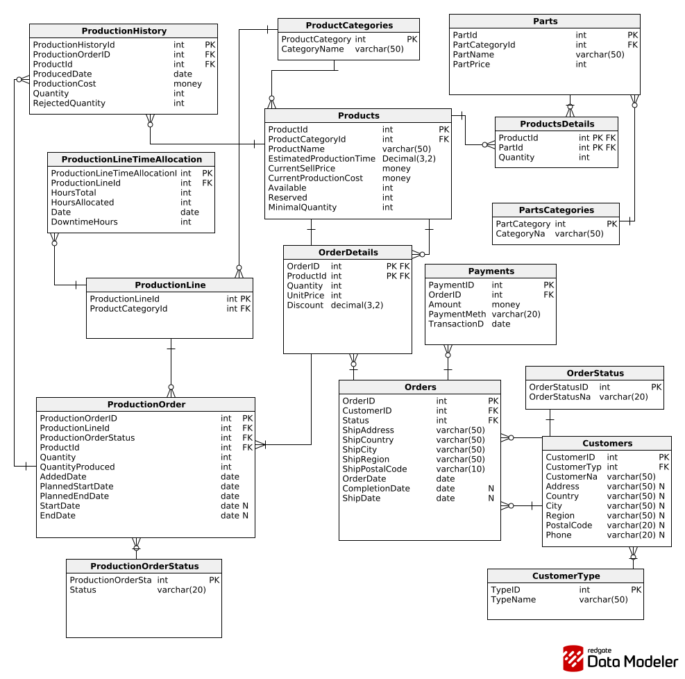

# Podstawy baz danych

Środa 13:15\
nr zespołu: 6

**Autorzy:**\
Błażej Turczynowicz\
Kacper Mucha\
Maciej Życki

# 1. Wymagania i funkcje systemu

## Historyjki użytkowników

### 1. Klient

- US-01: Przeglądanie oferty\
  Jako klient chcę przeglądać dostępne meble w ofercie, aby wybrać produkty odpowiednie do mojego biura.
- US-02: Składanie zamówienia z magazynu\
  Jako klient chcę złożyć zamówienie na dostępne produkty, aby szybko otrzymać meble.
- US-03: Zamówienie produktów do produkcji\
  Jako klient chcę zamówić produkty, których nie ma w magazynie, aby wyposażyć nową salę konferencyjną w danym temrinie.

### 2. Sprzedaż

- US-04: Przyznawanie rabatu\
  Jako pracownik sprzedaży chcę przydzielić rabat procentowy do poszczegolnych produktow w zamówieniu klienta, aby zachęcić do większego zakupu.
- US-05: Historia zamówień klienta\
  Jako pracownik sprzedaży chcę zobaczyć historię zamówień klienta wraz z rabatami, aby lepiej go obsłużyć.
- US-06: Stan magazynowy produktów\
  Jako pracownik sprzedaży chcę sprawdzić aktualny stan magazynowy produktów gotowych, aby wiedzieć co jest dostępne do sprzedaży.

### 3. Produkcja

- US-07: Sprawdzenie dostępności części\
  Jako kierownik produkcji chcę sprawdzić dostępność części do produkcji, aby określić czy mogę rozpocząć produkcję.
- US-08: Czesci w danym meblu\
  Jako kierownik produkcji chcę mieć możliwość sprawdzenia z jakich części składa sie dany produkt, aby wiedzieć co jest potrzebne do jego produkcji.
- US-09: Estymacja czasu produkcji\
  Jako kierownik produkcji chcę oszacowany czas potrzebny na wyprodukowanie produktu, aby lepiej zaplanowac rozkład produckji.
- US-10: Zaplanowana produckja\
  Jako kierownik produkcji chcę mieć możliwość sprawdzenia mebli zaplanowanych do produckji, aby lepiej zarządzać linia produkcyjną.
- US-11 Planowanie produkcji\
  Jako kierownik produkcji chce móc planowac czas operacyjny oraz obciązenie lini produkcyjnych, aby odpowiednio rozdzielać zlecenia produckcyjne

### 4. Magazyn

- US-12: Przyjęcie produktów z produkcji\
  Jako magazynier chcę zarejestrować przyjęcie gotowych produktów z produkcji, aby zaktualizować stan magazynowy.
- US-13: Stan części do produkcji\
  Jako magazynier chcę sprawdzić stan magazynowy części, aby zgłosić potrzebę zamówienia nowych.
- US-14: Historia magazynu\
  Jako magazynier chcę śledzić ruchy magazynowe, aby uniknąć nieporozumień.
- US-15: Zamawienie czesci\
  Jako magazynier chcę móc skladać zamowienia na części, aby uniknąć braków w magazynie.

### 5. Kadra Zarządcza

- US-16: Raport kosztów produkcji\
   Jako dyrektor finansowy chcę zobaczyć raport kosztów produkcji (jednostkowych i grup produktów) w różnych okresach, aby ustalić odpowiedni budżet.
- US-17: Raport sprzedaży\
  Jako dyrektor handlowy chcę zobaczyć raport sprzedaży oraz kosztów grup produktów w tygodniach/miesiącach, aby analizować trendy oraz ocenić rentowność.
- US-18: Plan produkcji\
  Jako dyrektor operacyjny chcę zobaczyć plan wytworzenia produktów w różnych przedziałach czasowych, aby monitorować obciążenie zakładu.

# 2. Baza danych

## Schemat bazy danych

Diagram v0\


Diagram v1\


## Schemat dzialania produkcji

W Tabeli produkty przechowywane są informacje o aktualnym stanie magazynowym (Available), zarezerwowanych produktach (Reserved) oraz docelowej minimalnej ilości sztuk na magazynie (MinimalQuantity).Gdy pole Available spadnie poniżej wartości MinimalQuantity składamy zamówienie na uzupełnienie braków.\
Gdy klient składa zamówienie używamy systemu ATP (Available-to-Promise). Polega on na na obliczeniu ilości dostępnych towarów do podanej daty . Obliczane jest to wzorem:

- ATP=Products.Available +\
  sum(ProductionOrder.Quantity) where PlannedEndDate<= (data podana przez klienta) -\
  Products.Reserved\

ATP informuje nas ile produktów jesteśmy w stanie dostarczyć uwzględniając aktualny stan magazynowy, produkcje które są relizowane oraz zaplanowane produkcje.
Jeśli ATP jest mniejsze od ilości zamówionej przez klienta przechodzimy na system CTP (Capable-to-Promise). Ponieważ zakładamy że częsci są zawsze dostępne sprowadza się to do znalezienia pierwszej daty która, jest w stanie zrealizować zamówienie. Jest on podobny do ATP ale uwzględnia możliwości produkcyjne i pozwala na zaplanowanie produkcji. Ilośc produktów potrzebnych do wyprodukowania obliczona jest przez:

- Required=ATP-(ilośc zamówiona przez klienta).

Czas potrzebny na wyprodukowanie możemy obliczyć przez Required\*Products.EstimatedProductionTime. Następnie allokujemy czas dla lini produkcyjnej do której należy produkt zaczynając od pierwszego dnia w którym linia nie jest używana przez cały dzień, data w której się to dzieje jest polem ProductionOrder.PlannedStartDate. W momencie gdy wyczerpiemy czas potrzebny na wyprodukowanie data w której się to dzieje zostaje ProductionOrder.PlannedEndDate.
Procedura ta jest powtarzana dla każdej pozycji zamówienia. Datą dla której determinujemy czy jesteśmy w stanie zrealizować zamówienia klienta jest maksymalna data ProdcutionOrder.PlannedEndDate.

### Przykład

Załóżmy że:

- Posiadamy 2 produkty
- Dzisiejszą data jest 13.12.2025

### Tabela: Produkty

| ProductID | EstimatedProductionTime | Available | Reserved | MinimalQuantity |
| --------- | ----------------------- | --------- | -------- | --------------- |
| 1         | 2                       | 2         | 5        | 10              |
| 2         | 4                       | 3         | 6        | 10              |

Ponieważ MinimalQuantity < Available, oznacza to że mamy 2 zamówienia w ProductionOrder.

### Tabela: ProductionOrder

| ProductionOrderID | ProductionLineID | ProductID | Quantity | StartDate  | PlannedEndDate |
| ----------------- | ---------------- | --------- | -------- | ---------- | -------------- |
| 1                 | 1                | 1         | 8        | 13.12.2025 | 15.12.2025     |
| 2                 | 2                | 2         | 7        | 13.12.2025 | 16.12.2025     |

### Tabela: ProductionLineTimeAllocation

| ProductionLineTimeAllocationID | ProductinLineID | HoursTotal | HoursAllocated | Date       |
| ------------------------------ | --------------- | ---------- | -------------- | ---------- |
| 1                              | 1               | 12         | 12             | 13.12.2025 |
| 2                              | 2               | 12         | 12             | 13.12.2025 |
| 3                              | 1               | 0          | 0              | 14.12.2025 |
| 4                              | 2               | 0          | 0              | 14.12.2025 |
| 5                              | 1               | 12         | 4              | 15.12.2025 |
| 6                              | 2               | 12         | 12             | 15.12.2025 |
| 7                              | 1               | 12         | 0              | 16.12.2025 |
| 8                              | 2               | 12         | 4              | 16.12.2025 |

Klient składa zamówienie na:

- 4 sztuk produktu o id=1 (Z<sub>1</sub>)
- 7 sztuk produktu o id=2 (Z<sub>2</sub>)
- maksymalna data podana przez klienta - 16.12.2025

Policzmy ATP dla każdej pozycji zamówienia:

- ATP<sub>1</sub> = Available + sum(ProductionOrder.Quantity) - Reserved = 2 + 8 - 5 = 5
- ATP<sub>2</sub> = Available + sum(ProductionOrder.Quantity) - Reserved = 3 + 7 - 6 = 4

Ponieważ ATP<sub>1</sub> >= Z<sub>1</sub> wiemy, że jesteśmy w w stanie dostarczyć produkty Z<sub>1</sub> w czasie podanym przez klienta.\
 Ale ATP<sub>2</sub> < Z<sub>2</sub>, więc nie jesteśmy w stanie dostarczyć produktów do wymaganej daty bez zlecania produkcji.

**Przechodzimy więc na system CTP.**\
Sprawdzamy ile produktu nam brakuje dla Z<sub>2</sub>.

- Braki = Z<sub>2</sub> - ATP<sub>2</sub> = 7 - 4 = 3
- Czas potrzebny na produkcje = 3\*4 = 12.

Przechodzimy przez kolejne dni sprawdzając możliwości produkcyjne dla lini na której produkowany jest potrzebny produkt, więc dla lini o id = 2, od pierwszej daty dla której jest możliwość zaalokwania czasu:

- dnia 16.12.2025 - Dostępna ilość wynosi 8. Pozostaje nam 12 - 8 = 4
- dnia 17.12.2025 - Dostępna ilosc godzin wynosi 12. Ponieważ 12>4 dzień ten jest datą w której skończy się produkcja.

Ponieważ obliczona data końca produkcji (17.12.2025) > data podana przez klienta (16.12.2025). Nie jesteśmy w stanie wyprodukować zamówienia, więc zamówienie nie zostanie zaakceptowane.\
Zmieńmy date podaną przez klienta na 18.12.2025. Oznacza to że obliczona data jest mniejsza. Więc akceptujemy zamówienie.\
Modyfikujemy wartości Products.Reserved dla odpowiednich produktów:

- id = 1: Reserved = 5 + 4 = 9
- id = 2: Reserved = 6 + 7 = 13

Dodajmy też nowe zamówienie na produkcje produktu. Stan tabeli ProductionOrder:

### Tabela: ProductionOrder

| ProductionOrderID | ProductionLineID | ProductID | Quantity | StartDate  | PlannedStartDate | PlannedEndDate |
| ----------------- | ---------------- | --------- | -------- | ---------- | ---------------- | -------------- |
| 1                 | 1                | 1         | 8        | 13.12.2025 | 13.12.2025       | 15.12.2025     |
| 2                 | 2                | 2         | 7        | 13.12.2025 | 13.12.2025       | 16.12.2025     |
| 3                 | 2                | 2         | 3        | NULL       | 16.12.2025       | 17.12.2025     |

Teraz należy sprawdzić czy zaplanowane produkty do produkcji uzupełnią nam stan magazynowy do MinimalQuantity. Robimy to licząc aktualne ATP

- id = 1, ATP<sub>Akt1</sub> = 2 + 8 - 9 = 1
- id = 2, ATP<sub>Akt2</sub> = 3 + 7 + 3 - 13 = 0

Ponieważ zarówno ATP<sub>Akt1</sub>,ATP<sub>Akt2</sub> są mniejsze od MinimalQuantity dla odpowiednich produktów. Tworzymy nowe zlecenia produkcyjne. Wymagana ilośc dla produktów to:

- id = 1, Quantity = MinimalQuantity - ATP<sub>Akt1</sub> = 10 - 1 = 9
- id = 2 , Quantity = MinimalQuantity - ATP<sub>Akt2</sub> = 10 - 0 = 10

Stan tabel po całej operacji wygląda następująco:

### Tbela: Products

| ProductID | EstimatedProductionTime | Available | Reserved | MinimalQuantity |
| --------- | ----------------------- | --------- | -------- | --------------- |
| 1         | 2                       | 2         | 9        | 10              |
| 2         | 3                       | 3         | 13       | 10              |

Stan tabeli ProductionOrder po złożeniu wszystkich zamówień produkcyjnych:

### Tabela: ProductionOrder

| ProductionOrderID | ProductionLineID | ProductID | Quantity | StartDate  | PlannedStartDate | PlannedEndDate |
| ----------------- | ---------------- | --------- | -------- | ---------- | ---------------- | -------------- |
| 1                 | 1                | 1         | 8        | 13.12.2025 | 13.12.2025       | 15.12.2025     |
| 2                 | 2                | 2         | 7        | 13.12.2025 | 13.12.2025       | 16.12.2025     |
| 3                 | 2                | 2         | 3        | NULL       | 16.12.2025       | 17.12.2025     |
| 4                 | 1                | 1         | 9        | NULL       | 15.12.2025       | 16.12.2025     |
| 5                 | 2                | 2         | 10       | NULL       | 17.12.2025       | 20.12.2025     |

Tabela zaalokowangeo czasu dla każdej lini:

### Tabela: ProductionLineTimeAllocation

| ProductionLineTimeAllocationID | ProductinLineID | HoursTotal | HoursAllocated | Date       |
| ------------------------------ | --------------- | ---------- | -------------- | ---------- |
| 1                              | 1               | 12         | 12             | 13.12.2025 |
| 2                              | 2               | 12         | 12             | 13.12.2025 |
| 3                              | 1               | 0          | 0              | 14.12.2025 |
| 4                              | 2               | 0          | 0              | 14.12.2025 |
| 5                              | 1               | 12         | 12             | 15.12.2025 |
| 6                              | 2               | 12         | 12             | 15.12.2025 |
| 7                              | 1               | 12         | 10             | 16.12.2025 |
| 8                              | 2               | 12         | 12             | 16.12.2025 |
| 9                              | 2               | 12         | 12             | 17.12.2025 |
| 10                             | 2               | 12         | 12             | 18.12.2025 |
| 11                             | 2               | 12         | 12             | 19.12.2025 |
| 12                             | 2               | 12         | 8              | 20.12.2025 |

## Opis poszczególnych tabel

### Tabela: Status

```sql
CREATE TABLE OrderStatus (
   OrderStatusID int  NOT NULL IDENTITY(1, 1),
   OrderStatusName varchar(20)  NOT NULL,
   CONSTRAINT OrderStatus_pk PRIMARY KEY  (OrderStatusID)
);
```

| Nazwa atrybutu | Typ         | Opis/Uwagi                                                                  |
| -------------- | ----------- | --------------------------------------------------------------------------- |
| StatusID       | int         | Auto-inkrementowany klucz główny, unikalny identyfikator statusu zamówienia |
| StatusName     | varchar(20) | Nazwa statusu dla zamówień                                                  |

### Tabela: CustomerType

```sql
CREATE TABLE CustomerType (
   TypeID int  NOT NULL IDENTITY(1, 1),
   TypeName varchar(50)  NOT NULL,
   CONSTRAINT CustomerType_pk PRIMARY KEY  (TypeID)
);
```

| Nazwa atrybutu | Typ         | Opis/Uwagi                                                            |
| -------------- | ----------- | --------------------------------------------------------------------- |
| TypeID         | int         | Auto-inkrementowany klucz główny, unikalny identyfikator typu klienta |
| TypeName       | varchar(50) | Nazwa typu klienta                                                    |

### Tabela: Customers

```sql
CREATE TABLE Customers (
   CustomerID int  NOT NULL IDENTITY(1, 1),
   CustomerType int  NOT NULL,
   CustomerName varchar  NOT NULL,
   Address varchar(50)  NULL,
   Country varchar(50)  NULL,
   City varchar(50)  NULL,
   Region varchar(50)  NULL,
   PostalCode varchar(20)  NULL,
   Phone varchar(20)  NULL,
   CONSTRAINT customerID PRIMARY KEY  (CustomerID),

   CONSTRAINT CustomerType_Customers FOREIGN KEY (CustomerType)
      REFERENCES CustomerType (TypeID)
);
```

| Nazwa atrybutu | Typ         | Opis/Uwagi                                                      |
| -------------- | ----------- | --------------------------------------------------------------- |
| CustomerID     | int         | Auto-inkrementowany klucz główny unikalny identyfikator klienta |
| CustomerType   | int         | Klucz obcy,identyfikator typu klienta                           |
| Adress         | varchar(50) | Adres klienta                                                   |
| Country        | varchar(50) | Kraj klienta                                                    |
| City           | varchar(50) | Miasto klienta                                                  |
| Region         | varchar(50) | Region klienta                                                  |
| PostalCode     | varchar(20) | Kod pocztowy klienta                                            |
| Phone          | varchar(20) | Numer telefonu klienta                                          |

### Tabela: Orders

```sql
CREATE TABLE Orders (
   OrderID int  NOT NULL IDENTITY(1, 1),
   CustomerID int  NOT NULL,
   EmployeeID int  NULL,
   Status int  NOT NULL,
   ShipAddress varchar(50)  NOT NULL,
   ShipCountry varchar(50)  NOT NULL,
   ShipCity varchar(50)  NOT NULL,
   ShipRegion varchar(50)  NOT NULL,
   ShipPostalCode varchar(20)  NOT NULL,
   OrderDate date  NOT NULL,
   CompletionDate date  NULL,
   ShipDate date  NULL,
   CONSTRAINT Orders_pk PRIMARY KEY  (OrderID),

   CONSTRAINT CHK_DATE CHECK ((CompletionDate is NULL OR OrderDate<=CompletionDate )  AND ( ShipDate is NULL OR CompletionDate<=ShipDate )),

   CONSTRAINT Orders_Status FOREIGN KEY (Status)
      REFERENCES Status (StatusID),

   CONSTRAINT Orders_Employees FOREIGN KEY (EmployeeID)
      REFERENCES Employees (EmployeeID)
         ON DELETE  SET NULL,

   CONSTRAINT Orders_Customers FOREIGN KEY (CustomerID)
      REFERENCES Customers (CustomerID)
         ON DELETE  CASCADE
);
```

| Nazwa atrybutu | Typ         | Opis/Uwagi                                                          |
| -------------- | ----------- | ------------------------------------------------------------------- |
| OrderID        | int         | Auto-inkrementowany klucz główny, unikalny identyfikator zamówienia |
| CustomerID     | int         | Klucz obcy,identyfikator klienta                                    |
| EmployeeID     | int         | Klucz obcy,identyfikator pracownika                                 |
| Status         | int         | Klucz obcy,identyfikator statusu                                    |
| ShipAddress    | varchar(50) | Adres wysyłki                                                       |
| ShipCountry    | varchar(50) | Kraj adresu wysyłki                                                 |
| ShipCity       | varchar(50) | Miasto adresu wysyłki                                               |
| ShipRegion     | varchar(20) | Region adresu wysyłki                                               |
| ShipPostalCode | varchar(20) | Kod pocztowy adresu wysyłki                                         |
| OrderDate      | date        | Data zamówienia                                                     |
| CompletionDate | date        | Data skompletowania zamówienia                                      |
| ShipDate       | date        | Data wysłania zamówienia                                            |

### Tabela: Payments

```sql
CREATE TABLE Payments (
   PaymentID int  NOT NULL IDENTITY(1, 1),
   OrderID int  NOT NULL,
   Amount money  NOT NULL CHECK (Amount>=0),
   PaymentMethod varchar(20)  NOT NULL,
   TransactionDate date  NOT NULL,

   CONSTRAINT Payments_pk PRIMARY KEY  (PaymentID),

   CONSTRAINT Payments_Orders FOREIGN KEY (OrderID)
      REFERENCES Orders (OrderID)
         ON DELETE  CASCADE
);
```

| Nazwa atrybutu  | Typ         | Opis/Uwagi                                                         |
| --------------- | ----------- | ------------------------------------------------------------------ |
| PaymentID       | int         | Auto-inkrementowany klucz główny, unikalny identyfikator płatności |
| OrderID         | int         | Klucz obcy,identyfikator zamówienia                                |
| Amount          | money       | Kwota płatności za zamówienie                                      |
| PaymentMethod   | varchar(20) | Metoda płatności za zamówienie                                     |
| TransactionDate | date        | Data transakcji                                                    |

### Tabela: OrderDetails

```sql
CREATE TABLE OrderDetails (
   OrderID int  NOT NULL,
   ProductId int  NOT NULL,
   Quantity int  NOT NULL CHECK (Quantity>0),
   UnitPrice int  NOT NULL CHECK (UnitPrice>0),
   Discount real  NOT NULL DEFAULT 0 CHECK (Discount>=0 AND Discount<=1),

   CONSTRAINT OrderDetails_pk PRIMARY KEY  (OrderID,ProductId),

   CONSTRAINT OrderDetails_Orders FOREIGN KEY (OrderID)
      REFERENCES Orders (OrderID)
        ON DELETE  CASCADE,

  CONSTRAINT OrderDetails_Products  FOREIGN KEY (ProductId)
      REFERENCES Products (ProductId)

);
```

| Nazwa atrybutu | Typ         | Opis/Uwagi                                       |
| -------------- | ----------- | ------------------------------------------------ |
| OrderID        | int         | Klucz obcy oraz główny ,identyfikator zamówienia |
| ProductID      | int         | Klucz obcy oraz główny ,identyfikator produktu   |
| Quantity       | money       | Ilość produktów w pozycji zamówienia             |
| UnitPrice      | varchar(20) | Cena jednostkowa za produkt                      |
| Discount       | real        | Rabat na pozycje zamówienia w przedziale [0,1]   |

### Tabela: Parts

```sql
CREATE TABLE Parts (
    PartId int  NOT NULL IDENTITY(1, 1),
    ProductCategoryId int  NOT NULL,
    PartName varchar(50) NOT NULL,
    Available int  NOT NULL,
    Reserved int  NOT NULL DEFAULT 0 CHECK (Reserved>=0),
    MinimalQuantity int  NOT NULL DEFAULT 0 CHECK (MinimalQuantity>=0),
    CONSTRAINT Parts_pk PRIMARY KEY  (PartId)

    CONSTRAINT Parts_PartsCategories  FOREIGN KEY (ProductCategoryId)
    REFERENCES PartsCategories (PartCategoryId);
);
```

**Opis:** Tabela przechowuje informacje o częściach/komponentach wykorzystywanych w produkcji.

| Nazwa atrybutu                    | Typ | Opis/Uwagi                                                          |
| --------------------------------- | --- | ------------------------------------------------------------------- |
| PartId                            | int | Klucz główny, unikalny identyfikator części                         |
| PartsCategories_ProductCategoryId | int | Klucz obcy do tabeli PartsCategories, identyfikuje kategorię części |
| Available                         | int | Liczba dostępnych sztuk części na magazynie                         |
| Reserved                          | int | Liczba zarezerwowanych sztuk części                                 |
| MinimalQuantity                   | int | Minimalna ilość części, która powinna być utrzymywana na magazynie  |

---

### Tabela: PartsCategories

```sql
CREATE TABLE PartsCategories (
    PartCategoryId int  NOT NULL IDENTITY(1, 1),
    CategoryName varchar(50)  NOT NULL,
    CONSTRAINT PartsCategories_pk PRIMARY KEY  (PartCategoryId)
);
```

| Nazwa atrybutu | Typ         | Opis/Uwagi                                            |
| -------------- | ----------- | ----------------------------------------------------- |
| PartCategoryId | int         | Klucz główny, unikalny identyfikator kategorii części |
| CategoryName   | varchar(50) | Nazwa kategorii części                                |

---

### Tabela: ProductCategories

```sql
CREATE TABLE ProductCategories (
    ProductCategoryID int  NOT NULL IDENTITY(1, 1),
    CategoryName varchar(50)  NOT NULL,
    CONSTRAINT ProductCategories_pk PRIMARY KEY  (ProductCategoryID)
);
```

| Nazwa atrybutu    | Typ         | Opis/Uwagi                                              |
| ----------------- | ----------- | ------------------------------------------------------- |
| ProductCategoryID | int         | Klucz główny, unikalny identyfikator kategorii produktu |
| CategoryName      | varchar(50) | Nazwa kategorii produktu                                |

---

### Tabela: Products

```sql
CREATE TABLE Products (
    ProductId int  NOT NULL IDENTITY(1,1),
    ProductCategoryId int  NOT NULL,
    ProductName varchar(50) NOT NULL,
    EstimatedProductionTime int  NOT NULL CHECK (EstimatedProductionTime>0),
    CurrentSellPrice money  NOT NULL CHECK (CurrentSellPrice>0),
    CurrentProductionCost money  NOT NULL CHECK (CurrentProductionCost>0),
    Available int  NOT NULL,
    Reserved int  NOT NULL DEFAULT 0 CHECK (Reserved>=0),
    MinimalQuantity int  NOT NULL CHECK (MinimalQuantity>=0),
    CONSTRAINT ProductID PRIMARY KEY  (ProductId)

    CONSTRAINT Products_ProductCategories FOREIGN KEY (ProductCategoryId)
    REFERENCES ProductCategories (ProductCategoryID);
);
```

| Nazwa atrybutu                   | Typ   | Opis/Uwagi                                                              |
| -------------------------------- | ----- | ----------------------------------------------------------------------- |
| ProductId                        | int   | Klucz główny, unikalny identyfikator produktu                           |
| ProductCategories_PartCategoryId | int   | Klucz obcy do tabeli ProductCategories, identyfikuje kategorię produktu |
| EstimatedProductionTime          | int   | Szacowany czas produkcji produktu w godzinach                           |
| CurrentSellPrice                 | money | Aktualna cena sprzedaży produktu                                        |
| CurrentProductionCost            | money | Aktualny koszt produkcji produktu                                       |
| Available                        | int   | Liczba dostępnych sztuk produktu na magazynie                           |
| Reserved                         | int   | Liczba zarezerwowanych sztuk produktu                                   |
| MinimalQuantity                  | int   | Minimalna ilość produktu, która powinna być utrzymywana na magazynie    |

---

### Tabela: ProductsDetails

```sql
CREATE TABLE ProductsDetails (
    ProductId int  NOT NULL,
    PartId int  NOT NULL,
    Quantity int  NOT NULL CHECK (Quantity>0),
    CONSTRAINT ProductsDetails_pk PRIMARY KEY  (ProductId, PartId)

    CONSTRAINT ProductsDetails_Products FOREIGN KEY (ProductId)
    REFERENCES Products (ProductId)
    ON DELETE  CASCADE;

    CONSTRAINT ProductsDetails_Parts FOREIGN KEY (PartId)
    REFERENCES Parts (PartId);
);
```

| Nazwa atrybutu     | Typ | Opis/Uwagi                                                             |
| ------------------ | --- | ---------------------------------------------------------------------- |
| Products_ProductId | int | Część klucza głównego, klucz obcy do tabeli Products                   |
| Parts_PartId       | int | Część klucza głównego, klucz obcy do tabeli Parts                      |
| Quantity           | int | Ilość danej części potrzebnej do wyprodukowania jednej sztuki produktu |

---

### Tabela: ProductionOrder

```sql
CREATE TABLE ProductionOrder (
   ProductionOrderID int  NOT NULL IDENTITY(1, 1),
   ProductionLineId int  NOT NULL,
   ProductionOrderStatus int  NOT NULL,
   ProductId int  NOT NULL,
   Quantity int  NOT NULL CHECK (Quantity>0),
   QuantityProduced int  NOT NULL DEFAULT 0 CHECK (QuantityProduced>=0),
   AddedDate date  NOT NULL,
   PlannedStartDate date  NOT NULL,
   PlannedEndDate date  NOT NULL,
   StartDate date  NULL,
   EndDate date  NULL,
   CONSTRAINT CHK_AddDate CHECK (AddedDate<=PlannedStartDate),
   CONSTRAINT CHK_PlannedDates CHECK (PlannedStartDate<=PlannedEndDate),
   CONSTRAINT CHK_RealDates CHECK (EndDate is Null OR StartDate<=EndDate ),
   CONSTRAINT CHK_Quantity CHECK (QuantityProduced<=Quantity),
   CONSTRAINT ProductionOrder_pk PRIMARY KEY  (ProductionOrderID)
);
```

| Nazwa atrybutu        | Typ  | Opis/Uwagi                                                  |
| --------------------- | ---- | ----------------------------------------------------------- |
| ProductionOrderID     | int  | Klucz główny, unikalny numer zlecenia produkcyjnego         |
| ProductionLineId      | int  | Klucz obcy, wskazuje linię produkcyjną realizującą zlecenie |
| ProductionOrderStatus | int  | Klucz obcy, określa aktualny status zlecenia                |
| ProductId             | int  | Klucz obcy, identyfikuje produkowany produkt                |
| Quantity              | int  | Planowana ilość produktu do wyprodukowania                  |
| QuantityProduced      | int  | Ilość produktu faktycznie wyprodukowana do tej pory         |
| AddedDate             | date | Data dodania zlecenia do systemu                            |
| PlannedStartDate      | date | Planowana data rozpoczęcia produkcji                        |
| PlannedEndDate        | date | Planowana data zakończenia produkcji                        |
| StartDate             | date | Rzeczywista data rozpoczęcia (pole może być puste)          |
| EndDate               | date | Rzeczywista data zakończenia (pole może być puste)          |

---

### Tabela: ProductionLine

```sql
CREATE TABLE ProductionLine (
   ProductionLineId int  NOT NULL IDENTITY(1, 1),
   ProductCategoryId int  NOT NULL,
   CONSTRAINT ProductionLine_pk PRIMARY KEY  (ProductionLineId)
);
```

| Nazwa atrybutu    | Typ | Opis/Uwagi                                                            |
| :---------------- | :-- | :-------------------------------------------------------------------- |
| ProductionLineId  | int | Klucz główny, unikalny identyfikator linii produkcyjnej               |
| ProductCategoryId | int | Klucz obcy, identyfikuje kategorię produktu przypisaną do danej linii |

---

### Tabela: ProductionHistory

```sql
CREATE TABLE ProductionHistory (
   ProductionHistoryId int  NOT NULL IDENTITY(1, 1),
   ProductionOrderID int  NOT NULL,
   ProductId int  NOT NULL,
   ProducedDate date  NOT NULL,
   ProductionCost money  NOT NULL CHECK (ProductionCost>0),
   CONSTRAINT ProductionHistory_pk PRIMARY KEY  (ProductionHistoryId)
);
```

| Nazwa atrybutu      | Typ   | Opis/Uwagi                                                          |
| :------------------ | :---- | :------------------------------------------------------------------ |
| ProductionHistoryId | int   | Klucz główny, unikalny identyfikator wpisu historii                 |
| ProductionOrderID   | int   | Klucz obcy, wiąże wpis historii z konkretnym zleceniem produkcyjnym |
| ProductId           | int   | Klucz obcy, identyfikuje wyprodukowany produkt                      |
| ProducedDate        | date  | Data wyprodukowania produktu                                        |
| ProductionCost      | money | Koszt produkcji produktu                                            |

---

### Tabela: ProductionLineTimeAllocation

```sql
CREATE TABLE ProductionLineTimeAllocation (
   ProductionLineTimeAllocationID int  NOT NULL IDENTITY(1),
   ProductionLineId int  NOT NULL,
   HoursTotal int  NOT NULL CHECK (HoursTotal>0),
   HoursAllocated int  NOT NULL DEFAULT 0 CHECK (HoursAllocated>0),
   Date date  NOT NULL,
   CONSTRAINT ProductionLineTimeAllocation_pk PRIMARY KEY  (ProductionLineTimeAllocationID)
);
```

| Nazwa atrybutu                 | Typ  | Opis/Uwagi                                                   |
| :----------------------------- | :--- | :----------------------------------------------------------- |
| ProductionLineTimeAllocationID | int  | Klucz główny, unikalny identyfikator alokacji czasu          |
| ProductionLineId               | int  | Klucz obcy, identyfikuje linię, której dotyczy alokacja      |
| HoursTotal                     | int  | Całkowita liczba godzin dostępnych na tej linii w danym dniu |
| HoursAllocated                 | int  | Liczba godzin, które zostały już zaalokowane na tej linii    |
| Date                           | date | Data, której dotyczy alokacja czasu                          |

---

### Tabela: ProductionOrderStatus

```sql
CREATE TABLE ProductionOrderStatus (
   ProductionOrderStatus int  NOT NULL IDENTITY(1),
   Status varchar(20)  NOT NULL,
   CONSTRAINT ProductionOrderStatus_pk PRIMARY KEY  (ProductionOrderStatus)
);
```

| Nazwa atrybutu        | Typ         | Opis/Uwagi                                                  |
| :-------------------- | :---------- | :---------------------------------------------------------- |
| ProductionOrderStatus | int         | Klucz główny, identyfikator statusu zlecenia                |
| Status                | varchar(20) | Tekstowa nazwa statusu (np. Oczekujące, W toku, Zakończone) |

# 3. Widoki, procedury/funkcje, triggery

## Widoki

(dla każdego widoku należy wkleić kod polecenia definiującego widok wraz z komentarzem)

```sql
crete or alter view vw_abc
as
select a from tab1
```

## Procedury/funkcje

(dla każdej procedury/funkcji należy wkleić kod polecenia definiującego procedurę wraz z komentarzem)

```sql
-- ...
```

## Triggery

(dla każdego triggera należy wkleić kod polecenia definiującego trigger wraz z komentarzem)

```sql
-- ...
```

# 4. Inne

(informacja o sposobie wygenerowania danych, uprawnienia …)
