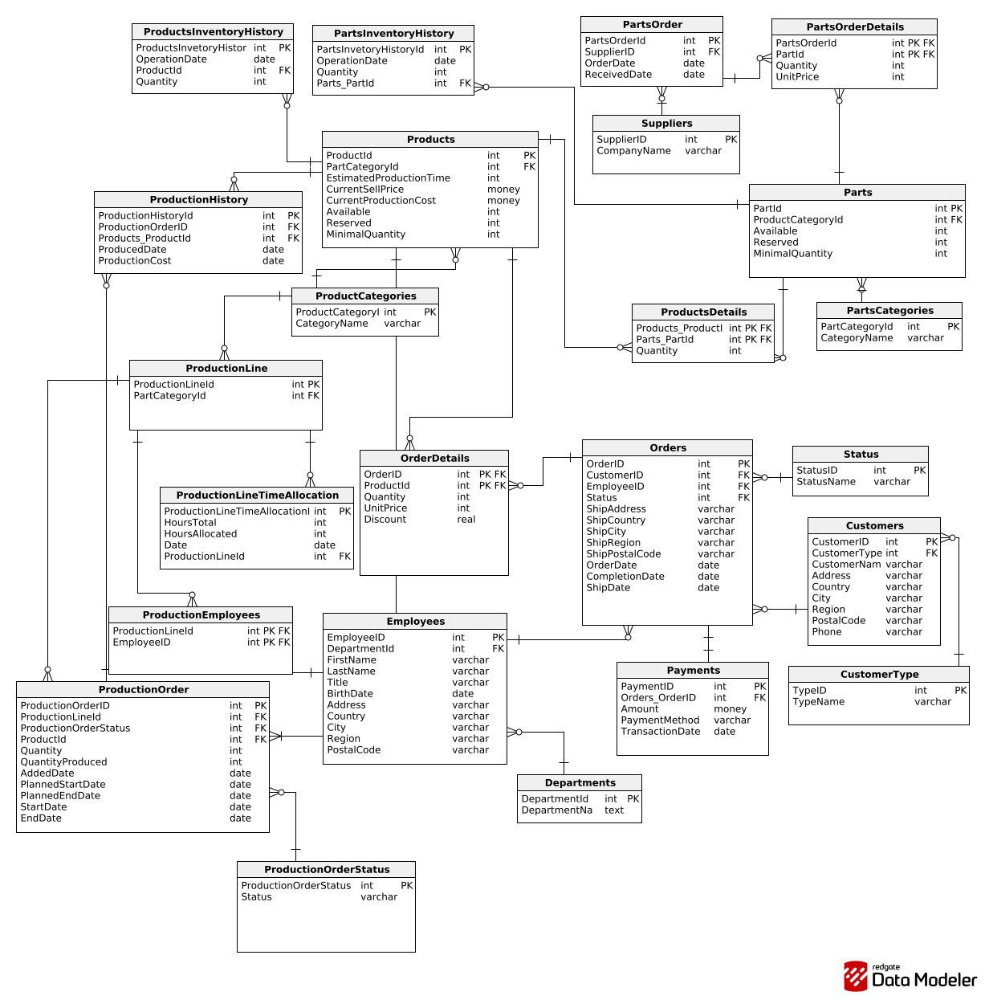

# Podstawy baz danych

Środa 13:15\
nr zespołu: 6

**Autorzy:**\
Błażej Turczynowicz\
Kacper Mucha\
Maciej Życki

# 1. Wymagania i funkcje systemu

## Historyjki użytkowników

### 1. Klient

- US-01: Przeglądanie oferty\
  Jako klient chcę przeglądać dostępne meble w ofercie, aby wybrać produkty odpowiednie do mojego biura.
- US-02: Składanie zamówienia z magazynu\
  Jako klient chcę złożyć zamówienie na dostępne produkty, aby szybko otrzymać meble.
- US-03: Zamówienie produktów do produkcji\
  Jako klient chcę zamówić produkty, których nie ma w magazynie, aby wyposażyć nową salę konferencyjną w danym temrinie.

### 2. Sprzedaż

- US-04: Przyznawanie rabatu\
  Jako pracownik sprzedaży chcę przydzielić rabat procentowy do poszczegolnych produktow w zamówieniu klienta, aby zachęcić do większego zakupu.
- US-05: Historia zamówień klienta\
  Jako pracownik sprzedaży chcę zobaczyć historię zamówień klienta wraz z rabatami, aby lepiej go obsłużyć.
- US-06: Stan magazynowy produktów\
  Jako pracownik sprzedaży chcę sprawdzić aktualny stan magazynowy produktów gotowych, aby wiedzieć co jest dostępne do sprzedaży.

### 3. Produkcja

- US-07: Sprawdzenie dostępności części\
  Jako kierownik produkcji chcę sprawdzić dostępność części do produkcji, aby określić czy mogę rozpocząć produkcję.
- US-08: Czesci w danym meblu\
  Jako kierownik produkcji chcę mieć możliwość sprawdzenia z jakich części składa sie dany produkt, aby wiedzieć co jest potrzebne do jego produkcji.
- US-09: Estymacja czasu produkcji\
  Jako kierownik produkcji chcę oszacowany czas potrzebny na wyprodukowanie produktu, aby lepiej zaplanowac rozkład produckji.
- US-10: Zaplanowana produckja\
  Jako kierownik produkcji chcę mieć możliwość sprawdzenia mebli zaplanowanych do produckji, aby lepiej zarządzać linia produkcyjną.
- US-11 Planowanie produkcji\
  Jako kierownik produkcji chce móc planowac czas operacyjny oraz obciązenie lini produkcyjnych, aby odpowiednio rozdzielać zlecenia produckcyjne

### 4. Magazyn

- US-12: Przyjęcie produktów z produkcji\
  Jako magazynier chcę zarejestrować przyjęcie gotowych produktów z produkcji, aby zaktualizować stan magazynowy.
- US-13: Stan części do produkcji\
  Jako magazynier chcę sprawdzić stan magazynowy części, aby zgłosić potrzebę zamówienia nowych.
- US-14: Historia magazynu\
  Jako magazynier chcę śledzić ruchy magazynowe, aby uniknąć nieporozumień.
- US-15: Zamawienie czesci\
  Jako magazynier chcę móc skladać zamowienia na części, aby uniknąć braków w magazynie.

### 5. Kadra Zarządcza

- US-16: Raport kosztów produkcji\
   Jako dyrektor finansowy chcę zobaczyć raport kosztów produkcji (jednostkowych i grup produktów) w różnych okresach, aby ustalić odpowiedni budżet.
- US-17: Raport sprzedaży\
  Jako dyrektor handlowy chcę zobaczyć raport sprzedaży oraz kosztów grup produktów w tygodniach/miesiącach, aby analizować trendy oraz ocenić rentowność.
- US-18: Plan produkcji\
  Jako dyrektor operacyjny chcę zobaczyć plan wytworzenia produktów w różnych przedziałach czasowych, aby monitorować obciążenie zakładu.

# 2. Baza danych

## Schemat bazy danych



## Opis poszczególnych tabel

### Tabela: ProductsInventoryHistory

```sql
CREATE TABLE ProductsInventoryHistory (
   ProductsInventoryHistoryId int  NOT NULL IDENTITY(1, 1),
   ProductId int  NOT NULL,
   OperationDate date  NOT NULL,
   Quantity int  NOT NULL,
   CONSTRAINT ProductsInventoryHistory_pk PRIMARY KEY  (ProductsInvetoryHistoryId),

   CONSTRAINT ProductsInventoryHistory_Products FOREIGN KEY (ProductId)
      REFERENCES Products (ProductId)
);
```

| Nazwa atrybutu             | Typ  | Opis/Uwagi                                                                               |
| -------------------------- | ---- | ---------------------------------------------------------------------------------------- |
| ProductsInventoryHistoryId | int  | Auto-inkrementowany klucz główny, unikalny indetyfikator operacji na magazynie produktów |
| ProductId                  | int  | Klucz obcy, indetyfikator produktu                                                       |
| OperationDate              | date | Data operacji                                                                            |
| Quantity                   | int  | Ilośc produktów dostarczonych do magazynu lub z niego zabranych                          |

### Tabela: PartsInventoryHistory

```sql
CREATE TABLE PartsInventoryHistory (
   PartsInventoryHistoryId int  NOT NULL IDENTITY(1, 1),
   PartId int  NOT NULL,
   OperationDate date  NOT NULL,
   Quantity int  NOT NULL,

   CONSTRAINT PartsInventoryHistory_pk PRIMARY KEY  (PartsInvetoryHistoryId),

   CONSTRAINT PartsInventoryHistory_Parts FOREIGN KEY (PartId)
      REFERENCES Parts (PartId)
);
```

| Nazwa atrybutu        | Typ  | Opis/Uwagi                                                                            |
| --------------------- | ---- | ------------------------------------------------------------------------------------- |
| PartsInventoryHistory | int  | Auto-inkrementowany klucz główny, unikalny indetyfikator operacji na magazynie części |
| PartID                | int  | Klucz obcy, indetyfikator części                                                      |
| OperationDate         | date | Data operacji                                                                         |
| Quantity              | int  | Ilośc produktów dostarczonych do magazynu lub z niego zabranych                       |

### Tabela: Suppliers

```sql
CREATE TABLE Suppliers (
   SupplierID int  NOT NULL IDENTITY(1, 1),
   CompanyName varchar(50)  NOT NULL,
   CONSTRAINT Suppliers_pk PRIMARY KEY  (SupplierID)
);
```

| Nazwa atrybutu | Typ         | Opis/Uwagi                                                        |
| -------------- | ----------- | ----------------------------------------------------------------- |
| SupplierID     | int         | Auto-inkrementowany klucz główny, unikalny indetyfikator dostawcy |
| CompanyName    | varchar(50) | Nazwa dostawcy                                                    |

### Tabela: PartsOrder

```sql
CREATE TABLE PartsOrder (
   PartsOrderId int  NOT NULL IDENTITY(1, 1),
   SupplierID int  NOT NULL,
   OrderDate date  NOT NULL,
   ReceivedDate date  NULL,

   CONSTRAINT CHK_date CHECK (ReceivedDate is Null OR OrderDate<=ReceivedDate),

   CONSTRAINT PartsOrder_pk PRIMARY KEY  (PartsOrderId),

   CONSTRAINT PartsOrder_Suppliers FOREIGN KEY (SupplierID)
      REFERENCES Suppliers (SupplierID)
);
```

| Nazwa atrybutu | Typ  | Opis/Uwagi                                                                 |
| -------------- | ---- | -------------------------------------------------------------------------- |
| PartsOrderID   | int  | Auto-inkrementowany klucz główny, unikalny indetyfikator zamówienia części |
| PartID         | int  | Klucz obcy, indetyfikator dostawcy                                         |
| OrderDate      | date | Data zamówienia                                                            |
| ReceivedDate   | int  | Data dostarczenia zamówienia                                               |

### Tabela: PartsOrderDetails

```sql
CREATE TABLE PartsOrderDetails (
   PartsOrderId int  NOT NULL,
   PartId int  NOT NULL,
   Quantity int  NOT NULL,
   UnitPrice int  NOT NULL,

   CONSTRAINT CHK_PartsOrderDetails CHECK (Quantity>0 AND UnitPrice>0),

   CONSTRAINT PartsOrderDetails_pk PRIMARY KEY  (PartsOrderId,PartId),

   CONSTRAINT PartsOrderDetails_PartsOrder FOREIGN KEY (PartsOrderId)
      REFERENCES PartsOrder (PartsOrderId)
          ON DELETE  CASCADE,

   CONSTRAINT PartsOrderDetails_Parts FOREIGN KEY (PartId)
      REFERENCES Parts (PartId)
);
```

| Nazwa atrybutu | Typ | Opis/Uwagi                                              |
| -------------- | --- | ------------------------------------------------------- |
| PartsOrderID   | int | Klucz główny oraz obcy, identyfiaktor zamówienia części |
| PartID         | int | Klucz główny oraz obcy, indetyfikator części            |
| Quantity       | int | Ilość części w zamówieniu                               |
| UnitPrice      | int | Cena jednostkowa za część                               |

### Tabela: Status

```sql
CREATE TABLE OrderStatus (
   OrderStatusID int  NOT NULL IDENTITY(1, 1),
   OrderStatusName varchar(20)  NOT NULL,
   CONSTRAINT OrderStatus_pk PRIMARY KEY  (OrderStatusID)
);
```

| Nazwa atrybutu | Typ         | Opis/Uwagi                                                                  |
| -------------- | ----------- | --------------------------------------------------------------------------- |
| StatusID       | int         | Auto-inkrementowany klucz główny, unikalny identyfikator statusu zamówienia |
| StatusName     | varchar(20) | Nazwa statusu dla zamówień                                                  |

### Tabela: Departments

```sql
CREATE TABLE Departments (
   DepartmentId int  NOT NULL IDENTITY(1, 1),
   DepartmentName varchar(50)  NOT NULL,
   CONSTRAINT Departments_pk PRIMARY KEY  (DepartmentId)
);
```

| Nazwa atrybutu | Typ         | Opis/Uwagi                                                      |
| -------------- | ----------- | --------------------------------------------------------------- |
| DepartmenID    | int         | Auto-inkrementowany klucz główny, unikalny identyfikator działu |
| DepartmentName | varchar(20) | Nazwa działu                                                    |

### Tabela: Employees

```sql
CREATE TABLE Employees (
   EmployeeID int  NOT NULL IDENTITY(1, 1),
   DepartmentId int  NULL,
   FirstName varchar(50)  NOT NULL,
   LastName varchar(50)  NOT NULL,
   Title varchar(50)  NOT NULL,
   BirthDate date  NOT NULL,
   Address varchar(50)  NOT NULL,
   Country varchar(50)  NOT NULL,
   City varchar(50)  NOT NULL,
   Region varchar(50)  NOT NULL,
   PostalCode varchar(20)  NOT NULL,
   CONSTRAINT Employees_pk PRIMARY KEY  (EmployeeID),

   CONSTRAINT Employees_Departments FOREIGN KEY (DepartmentId)
      REFERENCES Departments (DepartmentId)
        ON DELETE  SET NULL
);
```

| Nazwa atrybutu | Typ         | Opis/Uwagi                                            |
| -------------- | ----------- | ----------------------------------------------------- |
| EmployeeID     | int         | Auto-inkrementowany klucz główny, unikalny pracownika |
| DepartmentID   | int         | Klucz obcy,identyfikator działu                       |
| FirstName      | varchar(50) | Imie pracownika                                       |
| LastName       | varchar(50) | Nazwisko pracownika                                   |
| Title          | varchar(50) | Stanowisko pracownika                                 |
| BirthDate      | varchar(50) | Data urodzenia pracownika                             |
| Adress         | varchar(50) | Adres zamieszkania pracownika                         |
| Country        | varchar(50) | Kraj zamieszkania pracownika                          |
| City           | varchar(50) | Miasto zamieszkania pracownika                        |
| Region         | varchar(50) | Region zamieszkania pracownika                        |
| PostalCode     | varchar(20) | Kod pocztowy adresu zamieszkania pracownika           |

### Tabela: CustomerType

```sql
CREATE TABLE CustomerType (
   TypeID int  NOT NULL IDENTITY(1, 1),
   TypeName varchar(50)  NOT NULL,
   CONSTRAINT CustomerType_pk PRIMARY KEY  (TypeID)
);
```

| Nazwa atrybutu | Typ         | Opis/Uwagi                                                            |
| -------------- | ----------- | --------------------------------------------------------------------- |
| TypeID         | int         | Auto-inkrementowany klucz główny, unikalny identyfikator typu klienta |
| TypeName       | varchar(50) | Nazwa typu klienta                                                    |

### Tabela: Customers

```sql
CREATE TABLE Customers (
   CustomerID int  NOT NULL IDENTITY(1, 1),
   CustomerType int  NOT NULL,
   CustomerName varchar  NOT NULL,
   Address varchar(50)  NULL,
   Country varchar(50)  NULL,
   City varchar(50)  NULL,
   Region varchar(50)  NULL,
   PostalCode varchar(20)  NULL,
   Phone varchar(20)  NULL,
   CONSTRAINT customerID PRIMARY KEY  (CustomerID),

   CONSTRAINT CustomerType_Customers FOREIGN KEY (CustomerType)
      REFERENCES CustomerType (TypeID)
);
```

| Nazwa atrybutu | Typ         | Opis/Uwagi                                                      |
| -------------- | ----------- | --------------------------------------------------------------- |
| CustomerID     | int         | Auto-inkrementowany klucz główny unikalny identyfikator klienta |
| CustomerType   | int         | Klucz obcy,identyfikator typu klienta                           |
| Adress         | varchar(50) | Adres klienta                                                   |
| Country        | varchar(50) | Kraj klienta                                                    |
| City           | varchar(50) | Miasto klienta                                                  |
| Region         | varchar(50) | Region klienta                                                  |
| PostalCode     | varchar(20) | Kod pocztowy klienta                                            |
| Phone          | varchar(20) | Numer telefonu klienta                                          |

### Tabela: Orders

```sql
CREATE TABLE Orders (
   OrderID int  NOT NULL IDENTITY(1, 1),
   CustomerID int  NOT NULL,
   EmployeeID int  NULL,
   Status int  NOT NULL,
   ShipAddress varchar(50)  NOT NULL,
   ShipCountry varchar(50)  NOT NULL,
   ShipCity varchar(50)  NOT NULL,
   ShipRegion varchar(50)  NOT NULL,
   ShipPostalCode varchar(20)  NOT NULL,
   OrderDate date  NOT NULL,
   CompletionDate date  NULL,
   ShipDate date  NULL,
   CONSTRAINT Orders_pk PRIMARY KEY  (OrderID),

   CONSTRAINT CHK_DATE CHECK ((CompletionDate is NULL OR OrderDate<=CompletionDate )  AND ( ShipDate is NULL OR CompletionDate<=ShipDate )),

   CONSTRAINT Orders_Status FOREIGN KEY (Status)
      REFERENCES Status (StatusID),

   CONSTRAINT Orders_Employees FOREIGN KEY (EmployeeID)
      REFERENCES Employees (EmployeeID)
         ON DELETE  SET NULL,

   CONSTRAINT Orders_Customers FOREIGN KEY (CustomerID)
      REFERENCES Customers (CustomerID)
         ON DELETE  CASCADE
);
```

| Nazwa atrybutu | Typ         | Opis/Uwagi                                                          |
| -------------- | ----------- | ------------------------------------------------------------------- |
| OrderID        | int         | Auto-inkrementowany klucz główny, unikalny identyfikator zamówienia |
| CustomerID     | int         | Klucz obcy,identyfikator klienta                                    |
| EmployeeID     | int         | Klucz obcy,identyfikator pracownika                                 |
| Status         | int         | Klucz obcy,identyfikator statusu                                    |
| ShipAddress    | varchar(50) | Adres wysyłki                                                       |
| ShipCountry    | varchar(50) | Kraj adresu wysyłki                                                 |
| ShipCity       | varchar(50) | Miasto adresu wysyłki                                               |
| ShipRegion     | varchar(20) | Region adresu wysyłki                                               |
| ShipPostalCode | varchar(20) | Kod pocztowy adresu wysyłki                                         |
| OrderDate      | date        | Data zamówienia                                                     |
| CompletionDate | date        | Data skompletowania zamówienia                                      |
| ShipDate       | date        | Data wysłania zamówienia                                            |

### Tabela: Payments

```sql
CREATE TABLE Payments (
   PaymentID int  NOT NULL IDENTITY(1, 1),
   OrderID int  NOT NULL,
   Amount money  NOT NULL CHECK (Amount>=0),
   PaymentMethod varchar(20)  NOT NULL,
   TransactionDate date  NOT NULL,

   CONSTRAINT Payments_pk PRIMARY KEY  (PaymentID),

   CONSTRAINT Payments_Orders FOREIGN KEY (OrderID)
      REFERENCES Orders (OrderID)
         ON DELETE  CASCADE
);
```

| Nazwa atrybutu  | Typ         | Opis/Uwagi                                                         |
| --------------- | ----------- | ------------------------------------------------------------------ |
| PaymentID       | int         | Auto-inkrementowany klucz główny, unikalny identyfikator płatności |
| OrderID         | int         | Klucz obcy,identyfikator zamówienia                                |
| Amount          | money       | Kwota płatności za zamówienie                                      |
| PaymentMethod   | varchar(20) | Metoda płatności za zamówienie                                     |
| TransactionDate | date        | Data transakcji                                                    |

### Tabela: OrderDetails

```sql
CREATE TABLE OrderDetails (
   OrderID int  NOT NULL,
   ProductId int  NOT NULL,
   Quantity int  NOT NULL CHECK (Quantity>0),
   UnitPrice int  NOT NULL CHECK (UnitPrice>0),
   Discount real  NOT NULL DEFAULT 0 CHECK (Discount>=0 AND Discount<=1),

   CONSTRAINT OrderDetails_pk PRIMARY KEY  (OrderID,ProductId),

   CONSTRAINT OrderDetails_Orders FOREIGN KEY (OrderID)
      REFERENCES Orders (OrderID)
        ON DELETE  CASCADE,

  CONSTRAINT OrderDetails_Products  FOREIGN KEY (ProductId)
      REFERENCES Products (ProductId)

);
```

| Nazwa atrybutu | Typ         | Opis/Uwagi                                       |
| -------------- | ----------- | ------------------------------------------------ |
| OrderID        | int         | Klucz obcy oraz główny ,identyfikator zamówienia |
| ProductID      | int         | Klucz obcy oraz główny ,identyfikator produktu   |
| Quantity       | money       | Ilość produktów w pozycji zamówienia             |
| UnitPrice      | varchar(20) | Cena jednostkowa za produkt                      |
| Discount       | real        | Rabat na pozycje zamówienia w przedziale [0,1]   |

### Tabela: Parts

```sql
CREATE TABLE Parts (
    PartId int  NOT NULL IDENTITY(1, 1),
    ProductCategoryId int  NOT NULL,
    Available int  NOT NULL,
    Reserved int  NOT NULL DEFAULT 0 CHECK (Reserved>=0),
    MinimalQuantity int  NOT NULL DEFAULT 0 CHECK (MinimalQuantity>=0),
    CONSTRAINT Parts_pk PRIMARY KEY  (PartId)

    CONSTRAINT Parts_PartsCategories  FOREIGN KEY (ProductCategoryId)
    REFERENCES PartsCategories (PartCategoryId);
);
```

**Opis:** Tabela przechowuje informacje o częściach/komponentach wykorzystywanych w produkcji.

| Nazwa atrybutu                    | Typ | Opis/Uwagi                                                          |
| --------------------------------- | --- | ------------------------------------------------------------------- |
| PartId                            | int | Klucz główny, unikalny identyfikator części                         |
| PartsCategories_ProductCategoryId | int | Klucz obcy do tabeli PartsCategories, identyfikuje kategorię części |
| Available                         | int | Liczba dostępnych sztuk części na magazynie                         |
| Reserved                          | int | Liczba zarezerwowanych sztuk części                                 |
| MinimalQuantity                   | int | Minimalna ilość części, która powinna być utrzymywana na magazynie  |

---

### Tabela: PartsCategories

```sql
CREATE TABLE PartsCategories (
    PartCategoryId int  NOT NULL IDENTITY(1, 1),
    CategoryName varchar(50)  NOT NULL,
    CONSTRAINT PartsCategories_pk PRIMARY KEY  (PartCategoryId)
);
```

| Nazwa atrybutu | Typ         | Opis/Uwagi                                            |
| -------------- | ----------- | ----------------------------------------------------- |
| PartCategoryId | int         | Klucz główny, unikalny identyfikator kategorii części |
| CategoryName   | varchar(50) | Nazwa kategorii części                                |

---

### Tabela: ProductCategories

```sql
CREATE TABLE ProductCategories (
    ProductCategoryID int  NOT NULL IDENTITY(1, 1),
    CategoryName varchar(50)  NOT NULL,
    CONSTRAINT ProductCategories_pk PRIMARY KEY  (ProductCategoryID)
);
```

| Nazwa atrybutu    | Typ         | Opis/Uwagi                                              |
| ----------------- | ----------- | ------------------------------------------------------- |
| ProductCategoryID | int         | Klucz główny, unikalny identyfikator kategorii produktu |
| CategoryName      | varchar(50) | Nazwa kategorii produktu                                |

---

### Tabela: Products

```sql
CREATE TABLE Products (
    ProductId int  NOT NULL IDENTITY(1),
    ProductCategoryId int  NOT NULL,
    EstimatedProductionTime int  NOT NULL CHECK (EstimatedProductionTime>0),
    CurrentSellPrice money  NOT NULL CHECK (CurrentSellPrice>0),
    CurrentProductionCost money  NOT NULL CHECK (CurrentProductionCost>0),
    Available int  NOT NULL,
    Reserved int  NOT NULL DEFAULT 0 CHECK (Reserved>=0),
    MinimalQuantity int  NOT NULL CHECK (MinimalQuantity>=0),
    CONSTRAINT ProductID PRIMARY KEY  (ProductId)

    CONSTRAINT Products_ProductCategories FOREIGN KEY (ProductCategoryId)
    REFERENCES ProductCategories (ProductCategoryID);
);
```

| Nazwa atrybutu                   | Typ   | Opis/Uwagi                                                              |
| -------------------------------- | ----- | ----------------------------------------------------------------------- |
| ProductId                        | int   | Klucz główny, unikalny identyfikator produktu                           |
| ProductCategories_PartCategoryId | int   | Klucz obcy do tabeli ProductCategories, identyfikuje kategorię produktu |
| EstimatedProductionTime          | int   | Szacowany czas produkcji produktu w godzinach                           |
| CurrentSellPrice                 | money | Aktualna cena sprzedaży produktu                                        |
| CurrentProductionCost            | money | Aktualny koszt produkcji produktu                                       |
| Available                        | int   | Liczba dostępnych sztuk produktu na magazynie                           |
| Reserved                         | int   | Liczba zarezerwowanych sztuk produktu                                   |
| MinimalQuantity                  | int   | Minimalna ilość produktu, która powinna być utrzymywana na magazynie    |

---

### Tabela: ProductsDetails

```sql
CREATE TABLE ProductsDetails (
    ProductId int  NOT NULL,
    PartId int  NOT NULL,
    Quantity int  NOT NULL CHECK (Quantity>0),
    CONSTRAINT ProductsDetails_pk PRIMARY KEY  (ProductId, PartId)

    CONSTRAINT ProductsDetails_Products FOREIGN KEY (ProductId)
    REFERENCES Products (ProductId)
    ON DELETE  CASCADE;

    CONSTRAINT ProductsDetails_Parts
    FOREIGN KEY (PartId)
    REFERENCES Parts (PartId);
);
```

| Nazwa atrybutu     | Typ | Opis/Uwagi                                                             |
| ------------------ | --- | ---------------------------------------------------------------------- |
| Products_ProductId | int | Część klucza głównego, klucz obcy do tabeli Products                   |
| Parts_PartId       | int | Część klucza głównego, klucz obcy do tabeli Parts                      |
| Quantity           | int | Ilość danej części potrzebnej do wyprodukowania jednej sztuki produktu |

\
\
\
\
(Dla każdej tabeli kod DDL wraz z zaimplementowanymi war. integralności, + ewentualnie opis, np. w formie tabelki)

- kod DDL

```sql
create table tab1 (
   a int,
   b varchar(10)
)
```

- Opis: (opis tabeli, komentarz)
- np.

| Nazwa atrybutu | Typ | Opis/Uwagi |
| -------------- | --- | ---------- |
| Atrybut 1 …    |     |            |
| Atrybut 2 …    |     |            |

# 3. Widoki, procedury/funkcje, triggery

## Widoki

(dla każdego widoku należy wkleić kod polecenia definiującego widok wraz z komentarzem)

```sql
crete or alter view vw_abc
as
select a from tab1
```

## Procedury/funkcje

(dla każdej procedury/funkcji należy wkleić kod polecenia definiującego procedurę wraz z komentarzem)

```sql
-- ...
```

## Triggery

(dla każdego triggera należy wkleić kod polecenia definiującego trigger wraz z komentarzem)

```sql
-- ...
```

# 4. Inne

(informacja o sposobie wygenerowania danych, uprawnienia …)
